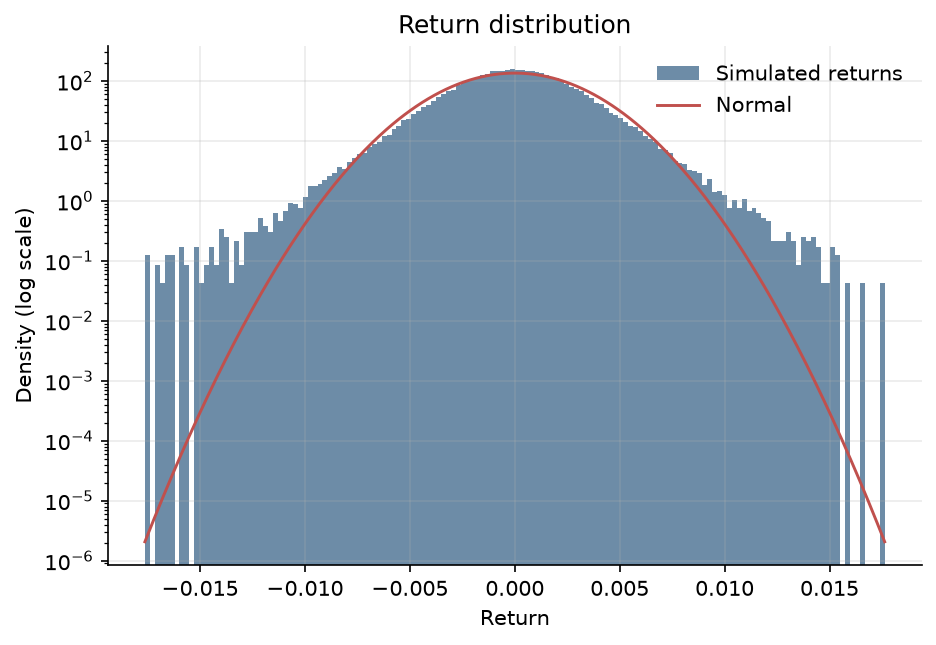
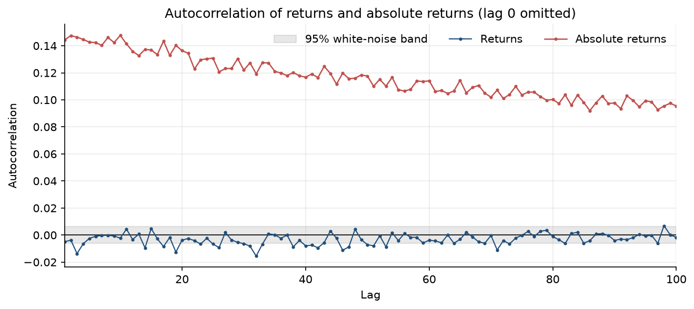

# market-sim

A reproducible agent-based toy market with fundamentalists, chartists and noise
traders.  The repository measures five stylized facts of financial returns with
explicit statistics instead of asserting them in prose.

The model is a controlled experiment, not a forecast.  The baseline run
reproduces all five facts under the stated criteria.  A 20-seed hold-out is
reported in `docs/robustness.md`: all six statistic rows pass on all 20 seeds.
The sensitivity analysis shows where that success comes from and which parameter
changes break it.

## Model

There are `N = 200` agents.  30% are fundamentalists, 40% are chartists and the
remaining 30% are noise traders.  Agent `i` has:

- a memory `M_i`, drawn uniformly from the integers between 5 and 1000,
- a risk-aversion coefficient `a_i`, drawn uniformly from [0.5, 2.0],
- a wealth weight `w_i`, drawn uniformly from [0.5, 1.5] and normalized to
  mean one,
- a fixed belief bias `b_i`, drawn from a normal distribution with standard
  deviation 0.03,
- a persistent activity state `c[i,t]`.

The log price is `p_t = log(P_t)` and the constant log fundamental value is
`f = log(100)`.  All demands below are expressed as fractions of initial
wealth.

### Activity

Each agent's activity follows a stationary log AR(1) process:

```text
log c[i,t] = rho_i log c[i,t-1] + sigma_a sqrt(1 - rho_i^2) xi[i,t]
rho_i      = 1 - 1 / M_i
c[i,t]     = exp(log c[i,t] - sigma_a^2 / 2)
```

`xi[i,t]` is standard normal and independent across agents and time.  The
subtraction inside the exponential makes `E[c[i,t]] = 1`.  Memory controls
persistence: an agent with `M_i = 1000` has `rho_i = 0.999`, while an agent
with `M_i = 5` has `rho_i = 0.8`.  For chartists, memory also sets the trend
window.  For fundamentalists and noise traders, memory acts only through the
persistence of activity.

Activity represents attention or participation.  It multiplies demand and is
the only source of persistent stochastic volatility in the model.  This is a
reduced-form behavioural state, not wealth.

### Demand rules

Fundamentalists trade against the gap between the fundamental value and the
price:

```text
d[i,t] = (w_i / a_i) c[i,t] F_max tanh( (kappa_f (f - p[t]) + b_i) / s_f )
```

Chartists follow the average log return over their memory window:

```text
trend[i,t] = (p[t] - p[t - M_i]) / M_i
d[i,t]     = (w_i / a_i) c[i,t] C_max tanh( kappa_c trend[i,t] / s_c )
```

Noise traders submit a zero-mean random demand:

```text
d[i,t] = (w_i / a_i) c[i,t] sigma_n epsilon[i,t]
```

`epsilon[i,t]` is standard normal.  The three rules differ only in the signal
that multiplies the common risk, wealth and activity terms.

### Price and volume

The price moves with excess demand:

```text
r[t+1] = lambda (1 / N) sum_i d[i,t]
p[t+1] = p[t] + r[t+1]
V[t]   = (1 / N) sum_i abs(d[i,t])
```

`lambda` is the price-impact parameter.  Volume is gross demand, not the change
in a position.  This definition matters for fact 4 and is discussed below.

### Baseline parameters

The complete configuration is in `configs/baseline.json`.

| Parameter | Value |
| --- | --- |
| `n_agents` | 200 |
| `fundamentalist_fraction` | 0.30 |
| `chartist_fraction` | 0.40 |
| noise fraction | 0.30, the remainder |
| `memory_min`, `memory_max` | 5, 1000, uniform integers |
| `risk_aversion_min`, `risk_aversion_max` | 0.5, 2.0, uniform |
| `wealth_min`, `wealth_max` | 0.5, 1.5, uniform, normalized to mean one |
| `fundamental_bias_std` | 0.03 |
| `activity_sigma` | 1.0 |
| `price_impact` | 0.05 |
| `kappa_fundamentalist`, `kappa_chartist` | 1.0, 1.0 |
| `fundamental_scale`, `chartist_scale` | 1.0, 0.002 |
| `max_fundamentalist_demand`, `max_chartist_demand` | 1.0, 0.1 |
| `noise_demand_scale` | 1.0 |
| `fundamental_value` | 100.0 |
| `seed` | 20261122 |
| `n_steps`, `burn_in` | 101000, 1000 |

The fundamental value is constant.  The model therefore has no long-run trends
and no exogenous news.  This is a deliberate simplification and a limitation.

## Reproducibility

Install the package:

```bash
python -m venv .venv
```

On Windows:

```powershell
.venv\Scripts\activate
```

On Linux or macOS:

```bash
source .venv/bin/activate
```

Then:

```bash
python -m pip install -e ".[dev]"
python scripts/run_simulation.py --config configs/baseline.json --output results
python scripts/make_figures.py --results results --output docs
python scripts/run_ensemble.py --config configs/baseline.json --seeds 1001-1020 --jobs 8
python -m pytest
```

`run_simulation.py` writes `series.csv`, `config.json`, `metrics.json` and
`results.md` under `results/`.  The `results/` directory is ignored by git.
`make_figures.py` reads `results/series.csv` when it exists and otherwise runs
the simulation in memory.

The same seed produces the same arrays:

```python
from market_sim import load_config, simulate

config = load_config("configs/baseline.json")
first = simulate(config)
second = simulate(config)
assert (first.prices == second.prices).all()
assert (first.returns == second.returns).all()
```

The simulation uses `numpy.random.default_rng`, which is PCG64.  NumPy does not
promise bit-for-bit identical `Generator` streams across every version, so the
committed numbers were produced in one reference environment: Python 3.14.5,
NumPy 2.5.5, Matplotlib 3.11.2, Windows 11.  CI runs Python 3.12, 3.13 and
3.14 on Ubuntu and Windows.

## Results

The table below is the output of:

```bash
python scripts/run_simulation.py --config configs/baseline.json --output results
```

Seed 20261122, 101,000 simulated steps, 1,000 burn-in steps, 100,000
observations in the table.

| Fact | Statistic | Value | Criterion | Pass |
| ---: | --- | ---: | --- | :---: |
| 1 | Kurtosis | 5.488 | > 3 | yes |
| 2 | ACF(returns, lag 1) | -0.004945 | abs(value) < 0.05 | yes |
| 3 | ACF(abs(returns), lag 1) | 0.1443 | > 0.05 | yes |
| 3 | ACF(abs(returns), lag 50) | 0.1176 | > 0.02 | yes |
| 4 | corr(volume, abs(returns)) | 0.5016 | > 0.2 | yes |
| 5 | P(abs(r) > 4 sd) / P_normal | 32.21 | > 1 | yes |

Fact 3 appears twice because its criterion has two parts.  The thresholds are
stored in `configs/baseline.json` under `metrics`.

### Reading the table

1. **Kurtosis 5.488.**  The return distribution is leptokurtic.  The tail
   statistic reinforces this: 0.204% of returns exceed four standard
   deviations, against 0.00633% under a normal distribution with the same
   variance.  The ratio is 32.21.  The two statistics are not independent
   evidence, they measure the same excess tail mass in different ways.
2. **ACF of returns -0.004945.**  The white-noise standard error is
   `1/sqrt(100000) = 0.00316`, so this is about 1.6 standard errors from zero.
   The criterion `abs(value) < 0.05` is an economic magnitude, not a
   significance test.
3. **ACF of absolute returns.**  The autocorrelation is 0.1443 at lag 1,
   0.1176 at lag 50, 0.0955 at lag 100 and 0.0581 at lag 200.  It stays
   positive and decays slowly over the simulated window.  It is not a true
   power law.  Each activity process is AR(1), so the mixture eventually decays
   exponentially.
4. **Volume and volatility 0.5016.**  This correlation is partly mechanical.
   Volume is gross demand and the return is proportional to net demand, so a
   positive relation is built into the accounting.  The number measures the
   strength of that channel, not an independent empirical discovery.
5. **Tail ratio 32.21.**  Four-sigma events are about 32 times more frequent
   than under a normal distribution.  This is consistent with the kurtosis.

### Figures


The price stays around the constant fundamental value.  The visible bursts of
activity are not long-run trends.



The empirical density lies above the normal curve in both tails.  The plot is
truncated at six standard deviations for readability.  The table and the
goodness statistics use all observations.



Returns are close to zero and mostly inside the 95% white-noise band.
Absolute returns remain positive and decay slowly.  Lag zero is omitted because
it is always one.

## Robustness across seeds

The baseline table is one seed.  `docs/robustness.md` repeats the full run on
seeds 1001 to 1020, which were not used to choose the parameters.  The command
is:

```bash
python scripts/run_ensemble.py --config configs/baseline.json --seeds 1001-1020 --jobs 8
```

| Statistic | Median | 5% | 95% | Min | Max | Seeds passing |
| --- | ---: | ---: | ---: | ---: | ---: | ---: |
| Kurtosis | 7.112 | 5.15 | 39.26 | 4.833 | 406.5 | 20/20 |
| ACF(returns, lag 1) | -0.002353 | -0.01004 | 0.00415 | -0.01542 | 0.01213 | 20/20 |
| ACF(abs(returns), lag 1) | 0.183 | 0.1483 | 0.2639 | 0.1423 | 0.3959 | 20/20 |
| ACF(abs(returns), lag 50) | 0.1202 | 0.09319 | 0.212 | 0.08556 | 0.2351 | 20/20 |
| corr(volume, abs(returns)) | 0.549 | 0.5096 | 0.6287 | 0.5093 | 0.7696 | 20/20 |
| Tail ratio | 51.31 | 35.15 | 69.32 | 34.1 | 69.62 | 20/20 |

The per-seed values are in `docs/robustness.csv`.

All six statistic rows pass on all 20 seeds.  The distribution matters as much
as the pass count:

- Kurtosis has median 7.112, a 5th percentile of 5.15 and a maximum of 406.5.
  The mean, 27.91, is dominated by one extreme seed.  The baseline value 5.488
  is a low draw, close to the 5th percentile.  The direction of fact 1 is
  robust.  The magnitude is not stable.
- The return ACF1 stays between -0.0154 and 0.0121, with median -0.00235.  It
  never approaches the 0.05 threshold.
- The absolute-return ACF is at least 0.1423 at lag 1 and 0.0856 at lag 50.
  Volatility clustering is strong at every horizon in the ensemble.
- Volume correlation has a minimum of 0.5093 and a median of 0.5490.
- The tail ratio has a minimum of 34.1 and a median of 51.31.

The ensemble is a seed hold-out, not a model-specification hold-out.  It does
not test whether a different model would produce the same facts.

## Sensitivity

The baseline parameters were chosen by hand after inspecting these statistics.
The main table is therefore an in-sample result, not a blind out-of-sample
prediction.  `docs/sensitivity.md` contains the full experiment and the exact
commands.  Each row changes one parameter and keeps the rest fixed.

| Variant | Change | Kurtosis | ACF1 | ACF(abs,1) | ACF(abs,50) | corr(volume,abs) | Tail ratio | Rows passing |
| --- | --- | ---: | ---: | ---: | ---: | ---: | ---: | ---: |
| Baseline | seed 20261122, activity_sigma 1.0, max_chartist_demand 0.1 | 5.488 | -0.0049 | 0.1443 | 0.1176 | 0.5016 | 32.21 | 6/6 |
| Strong chartists | max_chartist_demand 0.5 | 5.289 | 0.0505 | 0.1407 | 0.1133 | 0.4513 | 30.94 | 5/6 |
| Very strong chartists | max_chartist_demand 1.0 | 5.507 | 0.9103 | 0.8570 | 0.7377 | 0.1436 | 16.42 | 4/6 |
| Low activity | activity_sigma 0.5 | 3.131 | -0.0035 | 0.0156 | 0.0208 | 0.2462 | 2.53 | 5/6 |
| Alternative seed | seed 7 | 4.523 | -0.0045 | 0.1219 | 0.0809 | 0.4672 | 26.68 | 6/6 |

The main trade-off is between chartist strength and fact 2.  Raising
`max_chartist_demand` from 0.1 to 0.5 pushes ACF1 to 0.0505, just above the
threshold.  At 1.0 the returns become strongly autocorrelated and the volume
correlation also fails.  Strong trend following is incompatible with near-zero
return autocorrelation in this model.

The second trade-off is between activity volatility and fact 3.  With
`activity_sigma = 0.5`, kurtosis falls to 3.131, the lag-1 autocorrelation of
absolute returns falls to 0.0156 and fact 3 fails.  Persistent activity is the
mechanism behind the clustering.

The seed changes magnitudes.  Kurtosis moves from 5.488 to 4.523 and
ACF(abs,50) from 0.1176 to 0.0809 when the seed changes from 20261122 to 7.
All six statistic rows still pass.  The 20-seed ensemble above shows the full
sampling distribution.

## Limitations

- The fundamental value is constant.  The price is stationary and the model
  does not reproduce long-run trends, bubbles or fundamental news.
- Volatility clustering comes from the reduced-form activity state, not from
  chartist herding or wealth dynamics.  The behavioural interpretation is
  attention, but the model does not derive attention from profits.
- Chartists are deliberately weak.  The baseline value of
  `max_chartist_demand` is 0.1.  The sensitivity table shows that stronger
  chartists break fact 2.  The model does not establish that a realistic level
  of trend following is compatible with near-zero return autocorrelation.
- The volume-volatility correlation is partly mechanical because volume is
  gross demand.
- The slow decay of absolute-return autocorrelation is not true long memory.
  It is a mixture of AR(1) processes with a finite maximum memory.
- Fat-tail estimates are heavy-tailed across seeds.  In the 20-seed hold-out,
  kurtosis has median 7.112 and maximum 406.5.  The baseline 5.488 is a low
  draw.  The fact "kurtosis > 3" holds in 20/20 seeds, but the magnitude is not
  stable.
- There is no order book, no wealth update, no dividends, no short-selling
  constraint, no leverage effect and no gain-loss asymmetry.
- The thresholds used to classify the facts are choices.  They are explicit in
  the configuration file so that a reader can change them.

## Tests

```bash
python -m pytest
```

The suite has 109 tests and 97% branch coverage:

- reproducibility with the same seed, including a separate check for the agent
  population and the simulated series,
- kurtosis and autocorrelation on hand-built series with known values,
- tail and volume statistics, including constant-series and non-finite errors,
- the simulator with extreme parameters, checking that every output stays
  finite,
- the price-impact fixed point when demand is zero and the zero-impact case,
- CSV round-trips, malformed CSV files and configuration validation branches,
- multi-seed ensemble, summary and CSV export,
- all three figure functions with the Agg backend.

The CI workflow runs the quality job, the test matrix on Ubuntu and Windows
with Python 3.12, 3.13 and 3.14, and a wheel build with an installed-wheel
smoke test.  The workflow file is `.github/workflows/ci.yml`.

## Quality gates

- `ruff check .` and `ruff format --check .`
- `mypy src` in strict mode
- `pytest --cov=market_sim --cov-fail-under=90`
- `python -m build` and `twine check dist/*`
- installation and smoke test of the built wheel

These gates run on every push and pull request.  The local commands are in
`CONTRIBUTING.md`.

## License

MIT.  Copyright (c) 2026 Iker Abad.

Author: Iker Abad (GitHub: IkerAbad).

Citation metadata is in `CITATION.cff`.  Release notes are in `CHANGELOG.md`.
Contributor setup is in `CONTRIBUTING.md`.

## Español

Simulador de mercado basado en agentes, escrito para medir hechos estilizados
en lugar de afirmarlos.  El modelo es un juguete controlado, no una previsión.
La ejecución base reproduce los cinco hechos con los criterios indicados.  Una
retención de 20 semillas, no usadas para elegir los parámetros, también los
reproduce en 20/20.  El análisis de sensibilidad muestra de dónde sale ese
resultado y qué parámetro lo rompe.

### Modelo

Hay 200 agentes.  El 30% son fundamentalistas, el 40% son chartistas y el 30%
restante son ruido.  Cada agente tiene memoria, aversión al riesgo, riqueza,
un sesgo de creencia y un estado de actividad persistente.

- La actividad sigue un proceso AR(1) en logaritmos.  La persistencia es
  `rho_i = 1 - 1/M_i`.  La memoria se sortea uniformemente entre 5 y 1000.
- El fundamentalista compra cuando el precio está por debajo del valor
  fundamental y vende cuando está por encima.  Su demanda es
  `(w/a) c F_max tanh((kappa_f (f-p) + b)/s_f)`.
- El chartista sigue la rentabilidad media de su ventana de memoria.  Su
  demanda es `(w/a) c C_max tanh(kappa_c trend/s_c)`.
- El ruido envía una demanda aleatoria de media cero.
- El precio se ajusta por exceso de demanda: `r[t+1] = lambda (1/N) sum_i d[i,t]`.
- El volumen es la demanda bruta media: `V[t] = (1/N) sum_i abs(d[i,t])`.

El valor fundamental es constante, 100.  El precio es estacionario alrededor de
ese valor.  No hay noticias, tendencias de largo plazo ni dinámica de riqueza.

Todos los parámetros y la semilla están en `configs/baseline.json`.  La misma
semilla produce la misma serie.

### Resultados

Comando:

```bash
python scripts/run_simulation.py --config configs/baseline.json --output results
```

Semilla 20261122, 101.000 pasos simulados, 1.000 de calentamiento y 100.000
observaciones en la tabla.

| Hecho | Estadístico | Valor | Criterio | Cumple |
| ---: | --- | ---: | --- | :---: |
| 1 | Curtosis | 5.488 | > 3 | sí |
| 2 | ACF(retornos, lag 1) | -0.004945 | abs(valor) < 0.05 | sí |
| 3 | ACF(abs(retornos), lag 1) | 0.1443 | > 0.05 | sí |
| 3 | ACF(abs(retornos), lag 50) | 0.1176 | > 0.02 | sí |
| 4 | corr(volumen, abs(retornos)) | 0.5016 | > 0.2 | sí |
| 5 | P(abs(r) > 4 sd) / P_normal | 32.21 | > 1 | sí |

### Lectura honesta

- La curtosis es 5.488.  El 0.204% de los retornos supera cuatro desviaciones
  típicas, frente al 0.00633% de una normal.  El cociente es 32.21.  La curtosis
  y el cociente de colas miden el mismo exceso de masa en las colas, no son dos
  pruebas independientes.
- La autocorrelación de los retornos es -0.004945.  El error típico es 0.00316,
  así que está a unas 1.6 desviaciones típicas de cero.  El criterio de 0.05 es
  una magnitud económica, no un contraste de significación.
- La autocorrelación de los valores absolutos es 0.1443 en el lag 1, 0.1176 en
  el lag 50, 0.0955 en el lag 100 y 0.0581 en el lag 200.  Decae despacio, pero
  no es una ley de potencias.  Cada actividad es un AR(1), así que la mezcla
  acaba decayendo de forma exponencial.
- La correlación entre volumen y volatilidad es 0.5016.  Es en parte mecánica:
  el volumen es demanda bruta y el retorno es proporcional a la demanda neta.
  El número mide la fuerza de ese canal, no un descubrimiento empírico
  independiente.

Los parámetros base se eligieron a mano después de mirar estos estadísticos.
La tabla principal es, por tanto, un ajuste dentro de la muestra, no una
predicción ciega.  `docs/sensitivity.md` contiene el experimento completo y los
comandos exactos.

### Robustez

La tabla base es una sola semilla.  `docs/robustness.md` repite la ejecución
completa con las semillas 1001 a 1020, que no se usaron para elegir los
parámetros.

| Estadístico | Mediana | Mínimo | Máximo | Semillas que cumplen |
| --- | ---: | ---: | ---: | ---: |
| Curtosis | 7.112 | 4.833 | 406.5 | 20/20 |
| ACF(retornos, 1) | -0.002353 | -0.01542 | 0.01213 | 20/20 |
| ACF(abs, 1) | 0.183 | 0.1423 | 0.3959 | 20/20 |
| ACF(abs, 50) | 0.1202 | 0.08556 | 0.2351 | 20/20 |
| corr(volumen, abs) | 0.549 | 0.5093 | 0.7696 | 20/20 |
| Ratio de colas | 51.31 | 34.1 | 69.62 | 20/20 |

Los valores por semilla están en `docs/robustness.csv`.

Las seis filas pasan en 20/20 semillas.  La curtosis tiene mediana 7.112 y
máximo 406.5, así que el hecho 1 es robusto en dirección pero no en magnitud.
La ACF de los valores absolutos no baja de 0.1423 en el lag 1 ni de 0.0856 en
el lag 50.  La correlación volumen-volatilidad no baja de 0.5093.  Es una
retención de semillas, no de especificación del modelo.

### Qué rompe el resultado

- Si se sube `max_chartist_demand` de 0.1 a 0.5, la ACF de los retornos sube a
  0.0505 y el hecho 2 deja de cumplirse.  Con 1.0 la autocorrelación es 0.9103
  y también falla el hecho 4.  Un chartismo fuerte es incompatible con una
  autocorrelación de retornos cercana a cero en este modelo.
- Si se baja `activity_sigma` de 1.0 a 0.5, la curtosis cae a 3.131, la ACF de
  los valores absolutos en el lag 1 cae a 0.0156 y el hecho 3 falla.  La
  actividad persistente es el mecanismo que genera la agrupación de volatilidad.
- Si se cambia la semilla de 20261122 a 7, todos los criterios siguen
  cumpliéndose, pero las magnitudes cambian: curtosis 4.523 y ACF(abs,50)
  0.0809.  La tabla de 20 semillas muestra la distribución completa.
- No hay un ajuste universal.  El resultado depende de los parámetros y de la
  semilla.

### Limitaciones

- El valor fundamental es constante, así que no hay tendencias de largo plazo.
- La agrupación de volatilidad viene del estado de actividad, no de una
  dinámica de riqueza ni de comportamiento de rebaño entre chartistas.
- Los chartistas son débiles por construcción.  El modelo no demuestra que un
  nivel realista de seguimiento de tendencia sea compatible con el hecho 2.
- La correlación volumen-volatilidad es en parte mecánica.
- El decaimiento lento no es memoria larga verdadera.
- La curtosis es muy inestable entre semillas.  En la retención de 20 semillas
  tiene mediana 7.112 y máximo 406.5.  El valor base 5.488 es bajo.  El hecho 1
  se cumple en 20/20, pero la magnitud no es estable.
- No hay libro de órdenes, dividendos, noticias, efecto apalancamiento ni
  asimetría entre ganancias y pérdidas.
- Los umbrales son decisiones explícitas y se pueden cambiar en el fichero de
  configuración.

### Ejecución

```bash
python -m pip install -e ".[dev]"
python scripts/run_simulation.py --config configs/baseline.json --output results
python scripts/make_figures.py --results results --output docs
python scripts/run_ensemble.py --config configs/baseline.json --seeds 1001-1020 --jobs 8
python -m pytest
```

Las tres figuras están en `docs/`: serie de precios, histograma de retornos con
la normal superpuesta en escala logarítmica y autocorrelación de retornos y de
valores absolutos.

La suite tiene 109 tests y 97% de cobertura de ramas.  Las mismas comprobaciones
que CI se ejecutan con `ruff check .`, `ruff format --check .`, `mypy src` y
`pytest --cov=market_sim --cov-fail-under=90`.

### Licencia

MIT.  Copyright (c) 2026 Iker Abad.

Autor: Iker Abad (GitHub: IkerAbad).

Los metadatos de cita están en `CITATION.cff`.  Las notas de versión están en
`CHANGELOG.md`.
