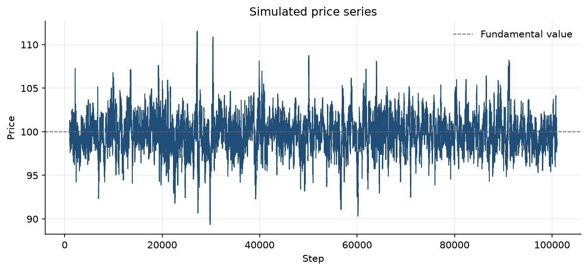
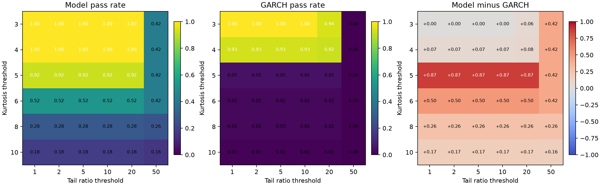

# market-sim

A reproducible agent-based toy market with fundamentalists, chartists and noise
traders.  The repository measures five stylized facts of financial returns with
explicit statistics instead of asserting them in prose.

The model is a controlled experiment, not a forecast.  The baseline run
reproduces all five facts under the stated criteria.  A 20-seed hold-out is
reported in `docs/robustness.md`: all six statistic rows pass on all 20 seeds.
Five additional diagnostics are reported separately, and the model reproduces
two of them.  An ablation study shows that the six statistic rows come from
the persistent activity process, not from the three agent types.  A noise-only
version passes all of them.  The types shape the price level and the return
autocorrelation.  See `docs/ablations.md`.

## Model

There are `N = 200` agents.  30% are fundamentalists, 40% are chartists and the
remaining 30% are noise traders.  Agent `i` has:

- a memory `M_i`, drawn uniformly from the integers between 5 and 1000,
- a risk-aversion coefficient `a_i`, drawn uniformly from [0.5, 2.0],
- a wealth weight `w_i`, drawn uniformly from [0.5, 1.5] and normalized to
  mean one,
- a fixed belief bias `b_i`, drawn from a normal distribution with standard
  deviation 0.03,
- a persistent activity state `c[i,t]`.

The log price is `p_t = log(P_t)` and the constant log fundamental value is
`f = log(100)`.  All demands below are expressed as fractions of initial
wealth.

### Activity

Each agent's activity follows a stationary log AR(1) process:

```text
log c[i,t] = rho_i log c[i,t-1] + sigma_a sqrt(1 - rho_i^2) xi[i,t]
rho_i      = 1 - 1 / M_i
c[i,t]     = exp(log c[i,t] - sigma_a^2 / 2)
```

`xi[i,t]` is standard normal and independent across agents and time.  The
subtraction inside the exponential makes `E[c[i,t]] = 1`.  Memory controls
persistence: an agent with `M_i = 1000` has `rho_i = 0.999`, while an agent
with `M_i = 5` has `rho_i = 0.8`.  For chartists, memory also sets the trend
window.  For fundamentalists and noise traders, memory acts only through the
persistence of activity.

Activity represents attention or participation.  It multiplies demand and is
the only source of persistent stochastic volatility in the model.  This is a
reduced-form behavioural state, not wealth.

### Demand rules

Fundamentalists trade against the gap between the fundamental value and the
price:

```text
d[i,t] = (w_i / a_i) c[i,t] F_max tanh( (kappa_f (f - p[t]) + b_i) / s_f )
```

Chartists follow the average log return over their memory window:

```text
trend[i,t] = (p[t] - p[t - M_i]) / M_i
d[i,t]     = (w_i / a_i) c[i,t] C_max tanh( kappa_c trend[i,t] / s_c )
```

Noise traders submit a zero-mean random demand:

```text
d[i,t] = (w_i / a_i) c[i,t] sigma_n epsilon[i,t]
```

`epsilon[i,t]` is standard normal.  The three rules differ only in the signal
that multiplies the common risk, wealth and activity terms.

### Price and volume

The price moves with excess demand:

```text
r[t+1] = lambda (1 / N) sum_i d[i,t]
p[t+1] = p[t] + r[t+1]
V[t]   = (1 / N) sum_i abs(d[i,t])
```

`lambda` is the price-impact parameter.  Volume is gross demand, not the change
in a position.  This definition matters for fact 4 and is discussed below.

### Baseline parameters

The complete configuration is in `configs/baseline.json`.

| Parameter | Value |
| --- | --- |
| `n_agents` | 200 |
| `fundamentalist_fraction` | 0.30 |
| `chartist_fraction` | 0.40 |
| noise fraction | 0.30, the remainder |
| `memory_min`, `memory_max` | 5, 1000, uniform integers |
| `risk_aversion_min`, `risk_aversion_max` | 0.5, 2.0, uniform |
| `wealth_min`, `wealth_max` | 0.5, 1.5, uniform, normalized to mean one |
| `fundamental_bias_std` | 0.03 |
| `activity_sigma` | 1.0 |
| `price_impact` | 0.05 |
| `kappa_fundamentalist`, `kappa_chartist` | 1.0, 1.0 |
| `fundamental_scale`, `chartist_scale` | 1.0, 0.002 |
| `max_fundamentalist_demand`, `max_chartist_demand` | 1.0, 0.1 |
| `noise_demand_scale` | 1.0 |
| `fundamental_value` | 100.0 |
| `seed` | 20261122 |
| `n_steps`, `burn_in` | 101000, 1000 |

The fundamental value is constant.  The model therefore has no long-run trends
and no exogenous news.  This is a deliberate simplification and a limitation.

## Reproducibility

Install the package:

```bash
python -m venv .venv
```

On Windows:

```powershell
.venv\Scripts\activate
```

On Linux or macOS:

```bash
source .venv/bin/activate
```

Then:

```bash
python -m pip install -e ".[dev]"
python scripts/run_simulation.py --config configs/baseline.json --output results
python scripts/make_figures.py --results results --output docs
python scripts/run_ensemble.py --config configs/baseline.json --seeds 1001-1020 --jobs 8
python -m pytest
```

`run_simulation.py` writes `series.csv`, `config.json`, `metrics.json` and
`results.md` under `results/`.  The `results/` directory is ignored by git.
`make_figures.py` reads `results/series.csv` when it exists and otherwise runs
the simulation in memory.

The same workflow is available through the package CLI:

```bash
market-sim simulate --config configs/baseline.json --output results
market-sim figures --results results --output docs
market-sim ensemble --config configs/baseline.json --seeds 1001-1020 --jobs 8
market-sim version
```

`python -m market_sim` accepts the same subcommands.  The inference, parameter
map and additional-facts reports are generated with `scripts/run_inference.py`,
`scripts/run_phase_diagram.py` and `scripts/run_extra_facts.py`.

Model card: `MODEL_CARD.md`.  Paper: `docs/paper.md`.  Environment and output
hashes: `docs/reproducibility.md`.  API reference: `docs/api.md`.
Architecture: `docs/architecture.md`.  Data dictionary:
`docs/data_dictionary.md`.  FAQ: `docs/faq.md`.

The same seed produces the same arrays:

```python
from market_sim import load_config, simulate

config = load_config("configs/baseline.json")
first = simulate(config)
second = simulate(config)
assert (first.prices == second.prices).all()
assert (first.returns == second.returns).all()
```

The simulation uses `numpy.random.default_rng`, which is PCG64.  NumPy does not
promise bit-for-bit identical `Generator` streams across every version, so the
committed numbers were produced in one reference environment: Python 3.14.5,
NumPy 2.5.5, Matplotlib 3.11.2, Windows 11.  CI runs Python 3.12, 3.13 and
3.14 on Ubuntu and Windows.

## Reproduce everything

`scripts/reproduce_all.py` runs the baseline, the figures, the ensembles, the
bootstrap, the phase map, the ablations, the sensitivity, the thresholds, the
additional facts, the benchmarks, the benchmark pass rates, the strict hold-out
table, the Gaussian null distribution, the discrimination grid, the additional
facts against the benchmarks, the performance timing, the sample-size scan, the
price-volume diagnostics, the block-stability table and the cross-seed block
table in order:

```bash
python scripts/reproduce_all.py --dry-run
python scripts/reproduce_all.py --jobs 8
python scripts/reproduce_all.py --skip-50-seeds
```

The full run takes several minutes and overwrites the generated files under
`results/` and `docs/`.  It ends by checking every README table against the
regenerated reports with `scripts/check_readme.py`.

## Results

The table below is the output of:

```bash
python scripts/run_simulation.py --config configs/baseline.json --output results
```

Seed 20261122, 101,000 simulated steps, 1,000 burn-in steps, 100,000
observations in the table.

| Fact | Statistic | Value | Criterion | Pass |
| ---: | --- | ---: | --- | :---: |
| 1 | Kurtosis | 5.488 | > 3 | yes |
| 2 | ACF(returns, lag 1) | -0.004945 | abs(value) < 0.05 | yes |
| 3 | ACF(abs(returns), lag 1) | 0.1443 | > 0.05 | yes |
| 3 | ACF(abs(returns), lag 50) | 0.1176 | > 0.02 | yes |
| 4 | corr(volume, abs(returns)) | 0.5016 | > 0.2 | yes |
| 5 | P(abs(r) > 4 sd) / P_normal | 32.21 | > 1 | yes |

Fact 3 appears twice because its criterion has two parts.  The thresholds are
stored in `configs/baseline.json` under `metrics`.

### Reading the table

1. **Kurtosis 5.488.**  The return distribution is leptokurtic.  The tail
   statistic reinforces this: 0.204% of returns exceed four standard
   deviations, against 0.00633% under a normal distribution with the same
   variance.  The ratio is 32.21.  The two statistics are not independent
   evidence, they measure the same excess tail mass in different ways.
2. **ACF of returns -0.004945.**  The white-noise standard error is
   `1/sqrt(100000) = 0.00316`, so this is about 1.6 standard errors from zero.
   The criterion `abs(value) < 0.05` is an economic magnitude, not a
   significance test.
3. **ACF of absolute returns.**  The autocorrelation is 0.1443 at lag 1,
   0.1176 at lag 50, 0.0955 at lag 100 and 0.0581 at lag 200.  It stays
   positive and decays slowly over the simulated window.  It is not a true
   power law.  Each activity process is AR(1), so the mixture eventually decays
   exponentially.
4. **Volume and volatility 0.5016.**  This correlation is partly mechanical.
   Volume is gross demand and the return is proportional to net demand, so a
   positive relation is built into the accounting.  The number measures the
   strength of that channel, not an independent empirical discovery.
5. **Tail ratio 32.21.**  Four-sigma events are about 32 times more frequent
   than under a normal distribution.  This is consistent with the kurtosis.

### Figures



The price stays around the constant fundamental value.  The visible bursts of
activity are not long-run trends.


The empirical density lies above the normal curve in both tails.  The plot is
truncated at six standard deviations for readability.  The table and the
goodness statistics use all observations.


Returns are close to zero and mostly inside the 95% white-noise band.
Absolute returns remain positive and decay slowly.  Lag zero is omitted because
it is always one.

## Robustness across seeds

The baseline table is one seed.  `docs/robustness.md` repeats the full run on
seeds 1001 to 1020, which were not used to choose the parameters.  The command
is:

```bash
python scripts/run_ensemble.py --config configs/baseline.json --seeds 1001-1020 --jobs 8
```

| Statistic | Median | 5% | 95% | Min | Max | Seeds passing |
| --- | ---: | ---: | ---: | ---: | ---: | ---: |
| Kurtosis | 7.112 | 5.15 | 39.26 | 4.833 | 406.5 | 20/20 |
| ACF(returns, lag 1) | -0.002353 | -0.01004 | 0.00415 | -0.01542 | 0.01213 | 20/20 |
| ACF(abs(returns), lag 1) | 0.183 | 0.1483 | 0.2639 | 0.1423 | 0.3959 | 20/20 |
| ACF(abs(returns), lag 50) | 0.1202 | 0.09319 | 0.212 | 0.08556 | 0.2351 | 20/20 |
| corr(volume, abs(returns)) | 0.549 | 0.5096 | 0.6287 | 0.5093 | 0.7696 | 20/20 |
| Tail ratio | 51.31 | 35.15 | 69.32 | 34.1 | 69.62 | 20/20 |

The per-seed values are in `docs/robustness.csv`.

All six statistic rows pass on all 20 seeds.  The distribution matters as much
as the pass count:

- Kurtosis has median 7.112, a 5th percentile of 5.15 and a maximum of 406.5.
  The mean, 27.91, is dominated by one extreme seed.  The baseline value 5.488
  is a low draw, close to the 5th percentile.  The direction of fact 1 is
  robust.  The magnitude is not stable.
- The return ACF1 stays between -0.0154 and 0.0121, with median -0.00235.  It
  never approaches the 0.05 threshold.
- The absolute-return ACF is at least 0.1423 at lag 1 and 0.0856 at lag 50.
  Volatility clustering is strong at every horizon in the ensemble.
- Volume correlation has a minimum of 0.5093 and a median of 0.5490.
- The tail ratio has a minimum of 34.1 and a median of 51.31.

The ensemble is a seed hold-out, not a model-specification hold-out.  It does
not test whether a different model would produce the same facts.

An extended hold-out over seeds 1001 to 1050 is in `docs/robustness_50.md`.
All 50 seeds pass the six rows.  The 95% Wilson interval for the all-pass rate
is [0.929, 1.000].  The kurtosis median is 6.304 and the minimum is 4.564.

## Statistical uncertainty

The ensemble measures variation across seeds.  `docs/inference.md` measures
within-series uncertainty with a moving-block bootstrap on the baseline path.
The command is:

```bash
python scripts/run_inference.py --config configs/baseline.json --results results --report docs/inference.md
```

| Statistic | Point estimate | Bootstrap mean | 95% interval |
| --- | ---: | ---: | ---: |
| Kurtosis | 5.488 | 5.521 | [4.235, 7.693] |
| ACF(returns, lag 1) | -0.004945 | -0.00504 | [-0.0125, 0.003521] |
| ACF(abs(returns), lag 1) | 0.1443 | 0.1442 | [0.1145, 0.1814] |
| ACF(abs(returns), lag 50) | 0.1176 | 0.1125 | [0.08772, 0.1444] |
| corr(volume, abs(returns)) | 0.5016 | 0.5021 | [0.4741, 0.5382] |
| Tail ratio | 32.21 | 32.31 | [23.52, 44.54] |

The bootstrap uses 200 resamples of contiguous blocks of 1000 observations.
The block length is well above the largest lag in the table (50).  Shorter
blocks attenuate the autocorrelation at long lags.

The return ACF1 interval contains zero.  The absolute-return ACF interval stays
above 0.087 at lag 50, the volume correlation stays above 0.47 and the tail
ratio stays above 23.  Kurtosis is the widest interval, from 4.235 to 7.693,
but it stays above 3.

These intervals are conditional on the model and the baseline parameters.
They are not confidence intervals for real-market facts.

## Sample size

`docs/sample_size.md` reruns seeds 1001 to 1003 at 10,000, 50,000, 100,000 and
200,000 steps.  The command is:

```bash
python scripts/run_sample_size.py --config configs/baseline.json --sizes 10000,50000,100000,200000 --seeds 1001-1003 --jobs 8
```

| Size | Seeds | Kurtosis | ACF(returns, 1) | ACF(abs, 1) | ACF(abs, 50) | corr | Tail | All-pass seeds |
| ---: | ---: | ---: | ---: | ---: | ---: | ---: | ---: | ---: |
| 10,000 | 3 | 5.987 | 0.0035 | 0.1620 | 0.0980 | 0.5308 | 48.53 | 3/3 |
| 50,000 | 3 | 12.090 | -0.0045 | 0.1943 | 0.1479 | 0.5602 | 47.68 | 3/3 |
| 100,000 | 3 | 11.542 | -0.0036 | 0.2048 | 0.1564 | 0.5728 | 51.77 | 3/3 |
| 200,000 | 3 | 9.263 | -0.0048 | 0.1907 | 0.1450 | 0.5586 | 49.16 | 3/3 |

All four sizes pass the six rows in all seeds.  Kurtosis is the most
sample-dependent statistic: it moves from 5.987 at 10,000 steps to 12.090 at
50,000, 11.542 at 100,000 and 9.263 at 200,000.  The other statistics are stable.
The 100,000-step baseline is not a special case.

## Sensitivity

The baseline parameters were chosen by hand after inspecting these statistics.
The main table is therefore an in-sample result, not a blind out-of-sample
prediction.  `docs/sensitivity.md` contains the full experiment and the exact
commands.  Each row changes one parameter and keeps the rest fixed.

| Variant | Change | Kurtosis | ACF1 | ACF(abs,1) | ACF(abs,50) | corr(volume,abs) | Tail ratio | Rows passing |
| --- | --- | ---: | ---: | ---: | ---: | ---: | ---: | ---: |
| Baseline | seed 20261122, activity_sigma 1.0, max_chartist_demand 0.1 | 5.488 | -0.0049 | 0.1443 | 0.1176 | 0.5016 | 32.21 | 6/6 |
| Strong chartists | max_chartist_demand 0.5 | 5.289 | 0.0505 | 0.1407 | 0.1133 | 0.4513 | 30.94 | 5/6 |
| Very strong chartists | max_chartist_demand 1.0 | 5.507 | 0.9103 | 0.8570 | 0.7377 | 0.1436 | 16.42 | 4/6 |
| Low activity | activity_sigma 0.5 | 3.131 | -0.0035 | 0.0156 | 0.0208 | 0.2462 | 2.53 | 5/6 |
| Alternative seed | seed 7 | 4.523 | -0.0045 | 0.1219 | 0.0809 | 0.4672 | 26.68 | 6/6 |

The main trade-off is between chartist strength and fact 2.  Raising
`max_chartist_demand` from 0.1 to 0.5 pushes ACF1 to 0.0505, just above the
threshold.  At 1.0 the returns become strongly autocorrelated and the volume
correlation also fails.  Strong trend following is incompatible with near-zero
return autocorrelation in this model.

The second trade-off is between activity volatility and fact 3.  With
`activity_sigma = 0.5`, kurtosis falls to 3.131, the lag-1 autocorrelation of
absolute returns falls to 0.0156 and fact 3 fails.  Persistent activity is the
mechanism behind the clustering.

The seed changes magnitudes.  Kurtosis moves from 5.488 to 4.523 and
ACF(abs,50) from 0.1176 to 0.0809 when the seed changes from 20261122 to 7.
All six statistic rows still pass.  The 20-seed ensemble above shows the full
sampling distribution.

## Parameter map

`docs/phase_diagram.md` scans a 5 by 5 grid of `activity_sigma` and
`max_chartist_demand` with three seeds per cell and 30,000 steps per seed.  The
command is:

```bash
python scripts/run_phase_diagram.py --config configs/baseline.json --seeds 1-3 --jobs 8
```


The baseline cell, `activity_sigma = 1.0` and `max_chartist_demand = 0.1`, is
outlined in red and passes all six rows in 3 of 3 seeds.  The map has two clear
failure directions:

- With `activity_sigma = 0.5`, the mean is 4.33 passing rows and no seed passes
  all six.  Low activity removes the volatility clustering required by fact 3.
- With `max_chartist_demand = 1.0`, the mean is between 3.33 and 5.00 passing
  rows and no seed passes all six.  Strong trend following creates return
  autocorrelation and breaks fact 2.

The all-pass region covers `activity_sigma` from 1.0 to 1.5 and
`max_chartist_demand` from 0.05 to 0.2 in this scan.  This is a coarse map, not
a substitute for the 100,000-step baseline.

## Ablations

`docs/ablations.md` removes one structural ingredient at a time over seeds 1001
to 1003.  The command is:

```bash
python scripts/run_ablations.py --config configs/baseline.json --seeds 1001-1003 --jobs 8
```

| Ablation | Kurtosis | ACF(returns, 1) | ACF(abs, 1) | ACF(abs, 50) | corr(volume, abs) | Tail ratio | Mean pass | All-pass seeds |
| --- | ---: | ---: | ---: | ---: | ---: | ---: | ---: | ---: |
| baseline | 3/3 | 3/3 | 3/3 | 3/3 | 3/3 | 3/3 | 6.00 | 3/3 |
| no_chartists | 3/3 | 3/3 | 3/3 | 3/3 | 3/3 | 3/3 | 6.00 | 3/3 |
| no_fundamentalists | 3/3 | 3/3 | 3/3 | 3/3 | 3/3 | 3/3 | 6.00 | 3/3 |
| noise_only | 3/3 | 3/3 | 3/3 | 3/3 | 3/3 | 3/3 | 6.00 | 3/3 |
| no_activity | 0/3 | 3/3 | 0/3 | 0/3 | 0/3 | 1/3 | 1.33 | 0/3 |
| fixed_memory | 3/3 | 3/3 | 3/3 | 3/3 | 3/3 | 3/3 | 6.00 | 3/3 |
| homogeneous_risk | 3/3 | 3/3 | 3/3 | 3/3 | 3/3 | 3/3 | 6.00 | 3/3 |
| homogeneous_wealth | 3/3 | 3/3 | 3/3 | 3/3 | 3/3 | 3/3 | 6.00 | 3/3 |
| no_bias | 3/3 | 3/3 | 3/3 | 3/3 | 3/3 | 3/3 | 6.00 | 3/3 |
| no_noise_demand | 3/3 | 0/3 | 3/3 | 3/3 | 3/3 | 3/3 | 5.00 | 0/3 |

The noise-only version passes all six rows.  Removing activity leaves only
1.33 rows on average and no seed passes all six.  Removing noise demand fails
the return autocorrelation.  The three-type composition is therefore not the
source of the statistical facts.  The types shape the price level and the
return autocorrelation, and the activity process supplies the clustering and
the tails.

## Full sensitivity

`docs/sensitivity_full.md` scans 32 one-at-a-time variants over seeds 1001 to
1003.  The command is:

```bash
python scripts/run_sensitivity_full.py --config configs/baseline.json --seeds 1001-1003 --jobs 8
```

Most variants pass all six rows, including price impact from 0.025 to 0.2,
noise demand from 0.5 to 5.0, the bias range, equal wealth and the
fundamentalist response.  The variants with at least one failing seed are:

- `activity_0.5`: ACF(abs, 1) fails in 3 of 3 seeds.
- `activity_2.0`: ACF(returns, 1) fails in 1 of 3 seeds.
- `chartist_0.50`: ACF(returns, 1) fails in 1 of 3 seeds.
- `chartist_1.00`: ACF(returns, 1) fails in 3 of 3 seeds and the volume
  correlation fails in 2 of 3.
- `risk_very_low`: ACF(returns, 1) fails in 3 of 3 seeds.
- `memory_very_short`: ACF(returns, 1) and ACF(abs, 50) fail in 3 of 3 seeds.
- `memory_short`: ACF(abs, 50) fails in 1 of 3 seeds.

The binding parameters are activity volatility, chartist strength, risk
aversion and memory.  Price impact, noise scale, bias, wealth and the
fundamentalist response are not the binding constraints in this range.

## Threshold sensitivity

`docs/thresholds.md` recomputes the 20-seed pass rate under stricter and looser
thresholds.  The command is:

```bash
python scripts/run_thresholds.py --input docs/robustness.csv --report docs/thresholds.md
```

| Fact | Threshold | Seeds passing |
| --- | ---: | ---: |
| Kurtosis | > 3 | 20/20 |
| Kurtosis | > 5 | 19/20 |
| Kurtosis | > 10 | 4/20 |
| ACF(returns, 1) | abs(value) < 0.01 | 18/20 |
| ACF(returns, 1) | abs(value) < 0.02 | 20/20 |
| ACF(abs, 1) | > 0.15 | 18/20 |
| ACF(abs, 1) | > 0.20 | 6/20 |
| ACF(abs, 50) | > 0.10 | 18/20 |
| ACF(abs, 50) | > 0.15 | 4/20 |
| corr(volume, abs) | > 0.50 | 20/20 |
| corr(volume, abs) | > 0.60 | 3/20 |
| Tail ratio | > 20 | 20/20 |
| Tail ratio | > 50 | 12/20 |

The facts survive stricter thresholds up to the margins shown.  Kurtosis and
the long-lag autocorrelation are the first to fail under very strict thresholds.

## Additional facts

The five target facts are not the whole story.  `docs/additional_facts.md`
measures five standard diagnostics that are outside the original list.  The
command is:

```bash
python scripts/run_extra_facts.py --results results --report docs/additional_facts.md
```

| Additional fact | Statistic | Value | Criterion | Pass |
| --- | --- | ---: | --- | :---: |
| Leverage effect | corr(r[t], abs(r[t+1])) | -0.0009623 | < -0.02 | no |
| Gain/loss asymmetry | std(losses) / std(gains) | 1 | > 1.05 | no |
| Long memory of abs(returns) | DFA Hurst exponent | 0.8548 | > 0.60 | yes |
| Volume leads volatility | best lag of corr(volume, abs(return)) | 0 | > 0 | no |
| Aggregational Gaussianity | kurtosis(60-step) / kurtosis(1-step) | 0.6107 | < 1 | yes |

The model reproduces the long-memory exponent and aggregational Gaussianity,
and fails the other three.

- The leverage effect is essentially zero.  The activity and noise processes
  are symmetric, so future volatility does not react asymmetrically to the
  sign of a past return.
- The gain/loss volatility ratio is 1.0000.  The same symmetry removes the
  usual asymmetry between negative and positive returns.
- Volume is gross demand at the same step as the return.  It is correlated with
  current volatility, as fact 4 shows, but it cannot lead future volatility.
  The best lag is 0.
- The DFA exponent is 0.8548.  The mixture of activity processes produces
  persistent absolute returns, consistent with the slow autocorrelation in
  fact 3.
- Aggregational Gaussianity holds.  The kurtosis falls from 5.488 at one step
  to 5.250 at 5 steps, 4.916 at 20 steps and 3.351 at 60 steps.  The ratio of
  the 60-step to the one-step value is 0.6107, below the threshold of 1.

The thresholds are explicit choices, like the thresholds in the main table.  A
failure here is a model limitation, not a simulator bug.

## Synthetic benchmarks

`docs/benchmarks.md` compares the model with three simple return processes.
The command is:

```bash
python scripts/run_benchmarks.py --config configs/baseline.json --results results --report docs/benchmarks.md
```

| Series | Kurtosis | ACF(returns, 1) | ACF(abs, 1) | ACF(abs, 50) | Tail ratio | Facts passing |
| --- | ---: | ---: | ---: | ---: | ---: | ---: |
| market-sim baseline | 5.488 | -0.004945 | 0.1443 | 0.1176 | 32.21 | 5/5 |
| Gaussian | 3.02 | -0.007337 | 0.003022 | -0.003043 | 0.6315 | 2/5 |
| Student-t(5) | 8.18 | 0.0008168 | -0.008656 | -0.001822 | 58.25 | 3/5 |
| GARCH(1,1) | 4.096 | -0.0004496 | 0.1532 | 0.04533 | 22.58 | 5/5 |

Gaussian returns fail the fat-tail and clustering facts.  Student-t returns
have fat tails but no clustering.  GARCH(1,1) passes the five price facts in
this sample.  The five facts alone therefore do not distinguish the agent-based
model from a simple stochastic-volatility benchmark.  The model's additional
content is the endogenous volume and the explicit agent rules.  The volume fact
is not in this table because the benchmarks have no volume.  This is a central
limitation of the five-fact exercise at the original thresholds.  The next
section repeats the benchmarks over many series and shows how stricter tail
criteria change the picture.

## Benchmark pass rates

A single benchmark series can pass by luck.  `docs/benchmark_rates.md` repeats
each synthetic process over 100 independent series of 100,000 returns and
reports the fraction that passes each fact.  The model row uses the 50 seeds in
`docs/robustness_50.csv`.  The command is:

```bash
python scripts/run_benchmark_rates.py --config configs/baseline.json --series 100 --n 100000
```

| Series | Kurtosis | ACF(returns, 1) | ACF(abs, 1) | ACF(abs, 50) | Tail ratio | All five | 95% CI |
| --- | ---: | ---: | ---: | ---: | ---: | ---: | ---: |
| market-sim baseline | 50/50 | 50/50 | 50/50 | 50/50 | 50/50 | 50/50 | [0.93, 1.00] |
| Gaussian | 52/100 | 100/100 | 0/100 | 0/100 | 47/100 | 0/100 | [0.00, 0.04] |
| Student-t(5) | 100/100 | 100/100 | 0/100 | 0/100 | 100/100 | 0/100 | [0.00, 0.04] |
| GARCH(1,1) | 100/100 | 100/100 | 100/100 | 100/100 | 100/100 | 100/100 | [0.96, 1.00] |

Under the original criteria the Gaussian process passes the kurtosis fact in
52 of 100 samples and the tail ratio in 47 of 100.  A sample kurtosis above 3
is weak evidence of fat tails at this sample size.  GARCH passes all five facts
in every sample, so the original criteria do not identify the agent-based
model.

Tightening the two weak tail criteria to kurtosis above 5 and tail ratio above
10 changes the result:

| Series | Kurtosis | ACF(returns, 1) | ACF(abs, 1) | ACF(abs, 50) | Tail ratio | All five | 95% CI |
| --- | ---: | ---: | ---: | ---: | ---: | ---: | ---: |
| market-sim baseline | 46/50 | 50/50 | 50/50 | 50/50 | 50/50 | 46/50 | [0.81, 0.97] |
| Gaussian | 0/100 | 100/100 | 0/100 | 0/100 | 0/100 | 0/100 | [0.00, 0.04] |
| Student-t(5) | 100/100 | 100/100 | 0/100 | 0/100 | 100/100 | 0/100 | [0.00, 0.04] |
| GARCH(1,1) | 5/100 | 100/100 | 100/100 | 100/100 | 100/100 | 5/100 | [0.02, 0.11] |

The model passes all five stricter facts in 46 of 50 seeds, 92%.  GARCH passes
in 5 of 100, and Gaussian and Student-t pass in none.  Raising the tail
thresholds therefore separates the agent-based model from the benchmarks.  The
main table keeps the original thresholds because they were fixed before these
runs.  The weakness of the original tail criteria is a documented limitation.

## Strict criteria on the hold-out

`docs/strict_criteria.md` applies the same strict thresholds to the 50-seed
hold-out.  The command is:

```bash
python scripts/run_strict_criteria.py --input docs/robustness_50.csv
```

| Fact | Criterion | Passes | 95% CI |
| --- | --- | ---: | ---: |
| Kurtosis | > 5 | 46/50 | [0.812, 0.968] |
| ACF(returns, 1) | abs(value) < 0.05 | 50/50 | [0.929, 1.000] |
| ACF(abs, 1) | > 0.05 | 50/50 | [0.929, 1.000] |
| ACF(abs, 50) | > 0.02 | 50/50 | [0.929, 1.000] |
| Tail ratio | > 10 | 50/50 | [0.929, 1.000] |
| All five | - | 46/50 | [0.812, 0.968] |

Four seeds fail only the strict kurtosis criterion: 1012 with 4.833, 1031 with
4.759, 1035 with 4.564 and 1046 with 4.982.  The other four facts pass on every
seed.  The strict criteria do not change the clustering conclusion, but they
make the kurtosis row honest.

## Null distribution under Gaussian noise

`docs/null_distribution.md` gives the 5%, 50% and 95% quantiles of each price
statistic over 1,000 independent Gaussian series of 100,000 returns, plus the
model value and its percentile in that null.  The command is:

```bash
python scripts/run_null_distribution.py --config configs/baseline.json --series 1000 --n 100000
```

| Statistic | Gaussian 5% | Median | 95% | Model | Model percentile |
| --- | ---: | ---: | ---: | ---: | ---: |
| Kurtosis | 2.975 | 3.001 | 3.028 | 5.488 | 100.0% |
| ACF(returns, 1) | -0.004923 | 0.000226 | 0.005366 | -0.004945 | 5.0% |
| ACF(abs, 1) | -0.004767 | -0.0001644 | 0.005291 | 0.1443 | 100.0% |
| ACF(abs, 50) | -0.005107 | -6.039e-06 | 0.005015 | 0.1176 | 100.0% |
| Tail ratio | 0.4736 | 0.9472 | 1.737 | 32.21 | 100.0% |

The kurtosis threshold of 3 is the median of the Gaussian null, so about half
of Gaussian samples pass it.  The model value 5.488 is far outside the 95%
quantile of 3.028.  The tail ratio behaves the same way: its Gaussian 95%
quantile is 1.737 and the model value is 32.21.  The return autocorrelation is
small in magnitude, near the 5% quantile of the null.  The absolute-return
autocorrelations are far above the Gaussian 95% quantile, and that is the part
of the table that a Gaussian process cannot reproduce.

## Discrimination from the benchmarks

A pass rate says whether a fact passes.  It does not say how much the fact
separates the model from a benchmark.  `docs/discrimination.md` measures that
with the area under the ROC curve: the probability that a random model value
is on the model side of a random benchmark value.  A value of 0.5 means no
separation.  The command is:

```bash
python scripts/run_discrimination.py --config configs/baseline.json --series 100 --n 100000
```

| Statistic | Model median | GARCH median | Gaussian median | AUC vs GARCH | AUC vs Gaussian |
| --- | ---: | ---: | ---: | ---: | ---: |
| Kurtosis | 6.304 | 4.28 | 3 | 0.962 [0.93, 0.99] | 1.000 [1.00, 1.00] |
| ACF(returns, 1) | -0.003142 | 0.000766 | 0.0002724 | 0.426 [0.33, 0.54] | 0.351 [0.25, 0.45] |
| ACF(abs, 1) | 0.169 | 0.1674 | -2.617e-05 | 0.517 [0.40, 0.63] | 1.000 [1.00, 1.00] |
| ACF(abs, 50) | 0.1126 | 0.05986 | -3.298e-05 | 0.989 [0.97, 1.00] | 1.000 [1.00, 1.00] |
| Tail ratio | 44.36 | 25.73 | 0.9472 | 0.985 [0.97, 1.00] | 1.000 [1.00, 1.00] |

The brackets are 95% bootstrap percentile intervals.  Kurtosis separates the
model from GARCH with AUC 0.962.  ACF(abs, 50) is stronger, with 0.989.
ACF(abs, 1) is close to a coin flip at 0.517, and its interval [0.40, 0.63]
contains 0.5, so the fast clustering fact does not distinguish the two models.
The slow autocorrelation is the stronger discriminator.

The threshold grid in the same report shows the separation region.  At
kurtosis > 4 and tail ratio > 10 the model passes all five in 50/50 seeds and
GARCH in 93/100.  At kurtosis > 5 the model passes 46/50 and GARCH falls to
5/100.  The separation is sharpest between 4 and 5.  The figure
`docs/discrimination.png` shows the model pass rate, the GARCH pass rate and
their difference over the full grid.



## Additional facts against the benchmarks

The five price facts are not the whole portfolio.  `docs/additional_discrimination.md`
compares the model, GARCH and Gaussian on the four additional facts that do not
need volume.  The volume lead-lag fact is omitted because the benchmarks have no
volume.  The command is:

```bash
python scripts/run_additional_discrimination.py --config configs/baseline.json --seeds 1001-1020 --series 100 --n 100000 --jobs 8
```

| Additional fact | Model median | GARCH median | Gaussian median | AUC vs GARCH | AUC vs Gaussian |
| --- | ---: | ---: | ---: | ---: | ---: |
| Leverage effect | 0.00426 | -0.0008269 | 0.0005386 | 0.298 | 0.352 |
| Gain/loss asymmetry | 0.9931 | 0.9992 | 0.9985 | 0.391 | 0.378 |
| DFA Hurst exponent | 0.8592 | 0.7378 | 0.5004 | 0.998 | 1.000 |
| Aggregational ratio | 0.7545 | 1.002 | 0.9977 | 0.804 | 0.840 |

DFA Hurst separates the model from GARCH with AUC 0.998.  Aggregational
Gaussianity separates them moderately, with 0.804: the model ratio is 0.755 and
the GARCH ratio is 1.002.  Leverage does not separate them in the intended
direction.  Its AUC is 0.298, and the model median is slightly positive,
0.00426, against -0.00083 for GARCH.  Gain/loss asymmetry is close to a coin
flip, with 0.391 and both medians near 1.  The additional facts add the DFA
exponent and aggregational Gaussianity to the discriminators.  Leverage and
gain/loss do not help.  The DFA exponent and ACF(abs, 50) are two views of the
same slow persistence.

## Price and volume

`docs/price_volume.md` describes the price gap around the fundamental value and
the volume series.  The command is:

```bash
python scripts/run_price_volume.py --config configs/baseline.json --results results --report docs/price_volume.md
```

| Statistic | Value |
| --- | ---: |
| Minimum price | 89.35 |
| Maximum price | 111.6 |
| Mean log gap | -0.002646 |
| Log gap standard deviation | 0.02011 |
| Log gap AR(1) coefficient | 0.9893 |
| Log gap half-life (steps) | 64.64 |
| Volume kurtosis | 5.99 |
| Volume ACF(1) | 0.5746 |
| Volume ACF(10) | 0.559 |
| corr(volume, abs(returns)) | 0.5016 |

The price gap is persistent, with a half-life of 64.6 steps.  The volume is
heavy-tailed and strongly autocorrelated.  These are descriptive diagnostics,
not target facts.

## Block stability

A single 100,000-step series can hide a result that comes from one short
episode.  `docs/stability.md` splits the analysis window into ten contiguous
blocks of 10,000 returns and recomputes the six statistics inside each block.
The command is:

```bash
python scripts/run_stability.py --config configs/baseline.json --results results --blocks 10
```

| Statistic | Mean | Min | Max | Blocks passing |
| --- | ---: | ---: | ---: | ---: |
| Kurtosis | 4.546 | 3.584 | 7.773 | 10/10 |
| ACF(returns, lag 1) | -0.003575 | -0.02629 | 0.02405 | 10/10 |
| ACF(abs(returns), lag 1) | 0.1198 | 0.07257 | 0.1952 | 10/10 |
| ACF(abs(returns), lag 50) | 0.0925 | 0.0577 | 0.1539 | 10/10 |
| corr(volume, abs(returns)) | 0.4818 | 0.3977 | 0.5505 | 10/10 |
| P(abs(r) > 4 sd) / P_normal | 26.36 | 12.63 | 59.99 | 10/10 |

Every statistic meets its full-sample criterion in every block.  Kurtosis is
the least stable row: its block minimum is 3.584, close to the threshold of 3.
This agrees with the seed and sample-size results.  The direction of the facts
is robust, the magnitude of the tail statistics is not.

## Block stability across seeds

One seed is one draw.  `docs/block_ensemble.md` repeats the block analysis on
the 20 hold-out seeds, which gives 200 blocks.  The command is:

```bash
python scripts/run_block_ensemble.py --config configs/baseline.json --seeds 1001-1020 --blocks 10 --jobs 8
```

| Statistic | Blocks passing | Rate | 95% CI |
| --- | ---: | ---: | ---: |
| Kurtosis | 200/200 | 100.0% | [98.1%, 100.0%] |
| ACF(returns, lag 1) | 199/200 | 99.5% | [97.2%, 99.9%] |
| ACF(abs(returns), lag 1) | 200/200 | 100.0% | [98.1%, 100.0%] |
| ACF(abs(returns), lag 50) | 200/200 | 100.0% | [98.1%, 100.0%] |
| corr(volume, abs(returns)) | 200/200 | 100.0% | [98.1%, 100.0%] |
| P(abs(r) > 4 sd) / P_normal | 200/200 | 100.0% | [98.1%, 100.0%] |

Nineteen of the 20 seeds pass all six statistics in all ten blocks.  The single
failure is seed 1020, block 10, steps 90,000 to 100,000.  Its return
autocorrelation is -0.05138, just outside the limit of 0.05.  Every other
statistic in that block passes.

## Bring your own data

No market data are bundled.  `scripts/compare_real_data.py` compares any CSV
with the model:

```bash
python scripts/compare_real_data.py --csv path/to/returns.csv --column return \
    --config configs/baseline.json --results results --report docs/real_data.md
```

The column can be a return series or a `price`/`close` column, which is
converted to log returns.  Use `--acf-lags 50` for series shorter than 200
observations.  The comparison uses the five price facts and does not calibrate
the model.  The data are not committed.

## Limitations

- The fundamental value is constant.  The price is stationary and the model
  does not reproduce long-run trends, bubbles or fundamental news.
- Volatility clustering comes from the reduced-form activity state, not from
  chartist herding or wealth dynamics.  The behavioural interpretation is
  attention, but the model does not derive attention from profits.
- The three-type composition is not necessary for the statistical facts.  A
  noise-only ablation passes all six rows.  The activity process is the source
  of the facts.  The types shape the price level and the return
  autocorrelation.
- Chartists are deliberately weak.  The baseline value of
  `max_chartist_demand` is 0.1.  The sensitivity table shows that stronger
  chartists break fact 2.  The model does not establish that a realistic level
  of trend following is compatible with near-zero return autocorrelation.
- The volume-volatility correlation is partly mechanical because volume is
  gross demand.
- The slow decay of absolute-return autocorrelation is not true long memory.
  It is a mixture of AR(1) processes with a finite maximum memory.
- Fat-tail estimates are heavy-tailed across seeds.  In the 20-seed hold-out,
  kurtosis has median 7.112 and maximum 406.5.  The baseline 5.488 is a low
  draw.  The fact "kurtosis > 3" holds in 20/20 seeds, but the magnitude is not
  stable.
- There is no order book, no wealth update, no dividends and no short-selling
  constraint.
- The model does not reproduce the leverage effect, gain/loss asymmetry or
  volume lead-lag.  The measured values are in `docs/additional_facts.md`.
- The five price facts are not unique to the model at the original thresholds.
  A GARCH(1,1) benchmark also passes all five in 100/100 samples.  The original
  kurtosis (>3) and tail-ratio (>1) criteria are weak: Gaussian samples pass
  them in about half of the cases.  With kurtosis >5 and tail ratio >10 the
  model passes all five in 46/50 seeds and GARCH in 5/100.  The main table keeps
  the original thresholds because they were fixed before these runs.
- The thresholds used to classify the facts are choices.  They are explicit in
  the configuration file so that a reader can change them.

## Tests

```bash
python -m pytest
```

The suite has 334 tests and 99% branch coverage:

- reproducibility with the same seed, including a separate check for the agent
  population, the simulated series and the committed baseline summary,
- kurtosis and autocorrelation on hand-built series with known values,
- tail, correlation and volume statistics, including constant-series,
  non-finite and tiny-scale errors,
- the simulator with extreme parameters, checking that every output stays
  finite,
- the price-impact fixed point when demand is zero and the zero-impact case,
- CSV round-trips, malformed CSV files and configuration validation branches,
- multi-seed ensemble, bootstrap, phase grid and additional-facts diagnostics,
  including aggregational Gaussianity,
- component ablations, one-at-a-time sensitivity and threshold sensitivity,
- synthetic benchmarks, benchmark pass rates, strict hold-out criteria,
  Gaussian null quantiles, discrimination AUC and the threshold grid, and
  performance timing,
- finite-sample, price-volume, block-stability and cross-seed block
  diagnostics,
- the real-data comparison loader and table,
- the command-line interface, including error paths and `python -m market_sim`,
- documentation link checks, version, results-table, API-documentation and
  output-hash consistency checks and release-note extraction,
- property-based tests with Hypothesis for statistical invariants,
- all three figure functions with the Agg backend.

The CI workflow runs the quality job, the test matrix on Ubuntu and Windows
with Python 3.12, 3.13 and 3.14, a pinned reference-environment job, a wheel
build with an installed-wheel smoke test, a container smoke test and a full
reproduction job.  The workflow file is `.github/workflows/ci.yml`.

## Quality gates

- `ruff check .` and `ruff format --check .`
- `mypy src` in strict mode
- `pytest --cov=market_sim --cov-fail-under=98`
- `python scripts/check_docs.py` for local documentation links
- `python scripts/check_versions.py` for version consistency
- `python scripts/check_results.py` for README table consistency
- `python scripts/check_readme.py` for every README results table
- `python scripts/build_api_docs.py --check` for API reference consistency
- `python scripts/check_hashes.py` for committed output hashes
- `python scripts/compare_baseline.py` after a baseline run
- `python -m build` and `twine check dist/*`
- installation and smoke test of the built wheel
- full 101,000-step baseline, all three figures and a 3-seed ensemble in CI
- property-based tests with Hypothesis
- pre-commit hooks for ruff, format and mypy
- pinned reference environment in `constraints-reference.txt`
- container smoke test in CI
- release workflow on `v*` tags
- bit-for-bit result hash comparison on Ubuntu and Windows
- PyPI trusted publishing and GHCR container publishing on tags

These gates run on every push and pull request.  The local commands are in
`CONTRIBUTING.md`.

## Performance

On the reference machine (Ryzen 9 5900X, 32 GB DDR4-3600, Windows 11), the
simulation loop takes 5.538 s for 100,000 steps and 200 agents.  That is about
18,058 steps/s or 3.61 million agent-steps/s.  `docs/performance.md` has the
full table.  Timing depends on the machine and is not part of the
byte-identical output table.  The command is:

```bash
python scripts/run_benchmark.py --config configs/baseline.json --steps 10000,50000,100000
```

## Releases

Pushing a `v*` tag triggers `.github/workflows/release.yml`.  The workflow
builds the sdist and wheel, runs `twine check`, publishes the distribution to
PyPI with trusted publishing, extracts the matching section from `CHANGELOG.md`,
creates the GitHub release with both artifacts and publishes the container to
GitHub Container Registry.  The version in `pyproject.toml`, `CITATION.cff` and
`src/market_sim/__init__.py` must match the tag.

## Container

The repository ships a `Dockerfile` with the package and the baseline
configuration.  The release image is published to GitHub Container Registry:

```bash
docker pull ghcr.io/ikerabad/market-sim:1.0.0
docker run --rm ghcr.io/ikerabad/market-sim:1.0.0 version
docker run --rm ghcr.io/ikerabad/market-sim:1.0.0 simulate --config configs/baseline.json --output /tmp/results
```

To build it locally:

```bash
docker build -t market-sim .
docker run --rm market-sim version
docker run --rm market-sim simulate --config configs/baseline.json --output /tmp/results
```

CI builds the image and runs a 500-step simulation inside it.

## License

MIT.  Copyright (c) 2026 Iker Abad.

Author: Iker Abad (GitHub: IkerAbad).

Citation metadata is in `CITATION.cff`.  Release notes are in `CHANGELOG.md`.
Contributor setup is in `CONTRIBUTING.md`.

## Español

Todas las tablas de esta sección se regeneran con
`python scripts/reproduce_all.py --jobs 8`.  Los comandos individuales de los
análisis más recientes aparecen junto a cada tabla.

Simulador de mercado basado en agentes, escrito para medir hechos estilizados
en lugar de afirmarlos.  El modelo es un juguete controlado, no una previsión.
La ejecución base reproduce los cinco hechos con los criterios indicados.  Una
retención de 20 semillas, no usadas para elegir los parámetros, también los
reproduce en 20/20.  Cinco diagnósticos adicionales se reportan aparte, y el
modelo solo reproduce dos de ellos.  La ablación muestra que las seis filas
vienen del proceso de actividad, no de los tres tipos.  Una versión solo de
ruido las pasa todas.  El análisis de sensibilidad muestra de dónde sale ese
resultado y qué parámetro lo rompe.  El artículo completo está en
`docs/paper.md`.

### Modelo

Hay 200 agentes.  El 30% son fundamentalistas, el 40% son chartistas y el 30%
restante son ruido.  Cada agente tiene memoria, aversión al riesgo, riqueza,
un sesgo de creencia y un estado de actividad persistente.

- La actividad sigue un proceso AR(1) en logaritmos.  La persistencia es
  `rho_i = 1 - 1/M_i`.  La memoria se sortea uniformemente entre 5 y 1000.
- El fundamentalista compra cuando el precio está por debajo del valor
  fundamental y vende cuando está por encima.  Su demanda es
  `(w/a) c F_max tanh((kappa_f (f-p) + b)/s_f)`.
- El chartista sigue la rentabilidad media de su ventana de memoria.  Su
  demanda es `(w/a) c C_max tanh(kappa_c trend/s_c)`.
- El ruido envía una demanda aleatoria de media cero.
- El precio se ajusta por exceso de demanda: `r[t+1] = lambda (1/N) sum_i d[i,t]`.
- El volumen es la demanda bruta media: `V[t] = (1/N) sum_i abs(d[i,t])`.

El valor fundamental es constante, 100.  El precio es estacionario alrededor de
ese valor.  No hay noticias, tendencias de largo plazo ni dinámica de riqueza.

Todos los parámetros y la semilla están en `configs/baseline.json`.  La misma
semilla produce la misma serie.  La arquitectura está en
`docs/architecture.md` y el diccionario de datos en `docs/data_dictionary.md`.

### Resultados

Comando:

```bash
python scripts/run_simulation.py --config configs/baseline.json --output results
```

Semilla 20261122, 101.000 pasos simulados, 1.000 de calentamiento y 100.000
observaciones en la tabla.

| Hecho | Estadístico | Valor | Criterio | Cumple |
| ---: | --- | ---: | --- | :---: |
| 1 | Curtosis | 5.488 | > 3 | sí |
| 2 | ACF(retornos, lag 1) | -0.004945 | abs(valor) < 0.05 | sí |
| 3 | ACF(abs(retornos), lag 1) | 0.1443 | > 0.05 | sí |
| 3 | ACF(abs(retornos), lag 50) | 0.1176 | > 0.02 | sí |
| 4 | corr(volumen, abs(retornos)) | 0.5016 | > 0.2 | sí |
| 5 | P(abs(r) > 4 sd) / P_normal | 32.21 | > 1 | sí |

### Lectura honesta

- La curtosis es 5.488.  El 0.204% de los retornos supera cuatro desviaciones
  típicas, frente al 0.00633% de una normal.  El cociente es 32.21.  La curtosis
  y el cociente de colas miden el mismo exceso de masa en las colas, no son dos
  pruebas independientes.
- La autocorrelación de los retornos es -0.004945.  El error típico es 0.00316,
  así que está a unas 1.6 desviaciones típicas de cero.  El criterio de 0.05 es
  una magnitud económica, no un contraste de significación.
- La autocorrelación de los valores absolutos es 0.1443 en el lag 1, 0.1176 en
  el lag 50, 0.0955 en el lag 100 y 0.0581 en el lag 200.  Decae despacio, pero
  no es una ley de potencias.  Cada actividad es un AR(1), así que la mezcla
  acaba decayendo de forma exponencial.
- La correlación entre volumen y volatilidad es 0.5016.  Es en parte mecánica:
  el volumen es demanda bruta y el retorno es proporcional a la demanda neta.
  El número mide la fuerza de ese canal, no un descubrimiento empírico
  independiente.

Los parámetros base se eligieron a mano después de mirar estos estadísticos.
La tabla principal es, por tanto, un ajuste dentro de la muestra, no una
predicción ciega.  `docs/sensitivity.md` contiene el experimento completo y los
comandos exactos.

### Robustez

La tabla base es una sola semilla.  `docs/robustness.md` repite la ejecución
completa con las semillas 1001 a 1020, que no se usaron para elegir los
parámetros.

| Estadístico | Mediana | Mínimo | Máximo | Semillas que cumplen |
| --- | ---: | ---: | ---: | ---: |
| Curtosis | 7.112 | 4.833 | 406.5 | 20/20 |
| ACF(retornos, 1) | -0.002353 | -0.01542 | 0.01213 | 20/20 |
| ACF(abs, 1) | 0.183 | 0.1423 | 0.3959 | 20/20 |
| ACF(abs, 50) | 0.1202 | 0.08556 | 0.2351 | 20/20 |
| corr(volumen, abs) | 0.549 | 0.5093 | 0.7696 | 20/20 |
| Ratio de colas | 51.31 | 34.1 | 69.62 | 20/20 |

Los valores por semilla están en `docs/robustness.csv`.

Las seis filas pasan en 20/20 semillas.  La curtosis tiene mediana 7.112 y
máximo 406.5, así que el hecho 1 es robusto en dirección pero no en magnitud.
La ACF de los valores absolutos no baja de 0.1423 en el lag 1 ni de 0.0856 en
el lag 50.  La correlación volumen-volatilidad no baja de 0.5093.  Es una
retención de semillas, no de especificación del modelo.

Una retención ampliada con las semillas 1001 a 1050 está en
`docs/robustness_50.md`.  Pasan las seis filas en 50/50.  El intervalo de
Wilson del 95% para la tasa de paso es [0.929, 1.000].  La curtosis tiene
mediana 6.304 y mínimo 4.564.

### Incertidumbre y mapa

El bootstrap de bloques de `docs/inference.md` da intervalos del 95% para la
ejecución base.  La ACF de los valores absolutos en el lag 50 queda en
[0.08772, 0.1444], la correlación volumen-volatilidad en [0.4741, 0.5382] y la
curtosis en [4.235, 7.693].  La ACF de los retornos contiene cero.

El mapa de `docs/phase_diagram.md` cruza `activity_sigma` y
`max_chartist_demand` con tres semillas por celda y 30.000 pasos.  Las seis
filas pasan con `activity_sigma` entre 1.0 y 1.5 y `max_chartist_demand` entre
0.05 y 0.2.  Con `activity_sigma = 0.5` falla el hecho 3.  Con
`max_chartist_demand = 1.0` falla el hecho 2.  La celda base está marcada en
rojo en la figura.

### Tamaño de muestra

`docs/sample_size.md` repite el modelo con 10.000, 50.000, 100.000 y 200.000
pasos y 3 semillas.  Las seis filas pasan en los cuatro tamaños y en 3/3
semillas.  La curtosis es la más dependiente: 5.987, 12.090, 11.542 y 9.263.
El resto es estable.  La base de 100.000 no es un caso especial.

### Qué rompe el resultado

- Si se sube `max_chartist_demand` de 0.1 a 0.5, la ACF de los retornos sube a
  0.0505 y el hecho 2 deja de cumplirse.  Con 1.0 la autocorrelación es 0.9103
  y también falla el hecho 4.  Un chartismo fuerte es incompatible con una
  autocorrelación de retornos cercana a cero en este modelo.
- Si se baja `activity_sigma` de 1.0 a 0.5, la curtosis cae a 3.131, la ACF de
  los valores absolutos en el lag 1 cae a 0.0156 y el hecho 3 falla.  La
  actividad persistente es el mecanismo que genera la agrupación de volatilidad.
- Si se cambia la semilla de 20261122 a 7, todos los criterios siguen
  cumpliéndose, pero las magnitudes cambian: curtosis 4.523 y ACF(abs,50)
  0.0809.  La tabla de 20 semillas muestra la distribución completa.
- No hay un ajuste universal.  El resultado depende de los parámetros y de la
  semilla.

### Ablaciones

`docs/ablations.md` elimina un componente cada vez con las semillas 1001 a 1003.

| Ablación | Media de filas | Semillas con todo |
| --- | ---: | ---: |
| baseline | 6.00 | 3/3 |
| no_chartists | 6.00 | 3/3 |
| no_fundamentalists | 6.00 | 3/3 |
| noise_only | 6.00 | 3/3 |
| no_activity | 1.33 | 0/3 |
| no_noise_demand | 5.00 | 0/3 |

La versión solo de ruido pasa las seis filas.  Sin actividad quedan 1.33 filas
de media.  Sin demanda de ruido falla la ACF de retornos.  Los tres tipos no son
la fuente de los hechos.  La actividad sí.

### Sensibilidad completa y umbrales

`docs/sensitivity_full.md` prueba 32 variantes una a una con las semillas 1001
a 1003.  La mayoría pasa las seis filas.  Fallan `activity_0.5`,
`activity_2.0`, `chartist_0.50`, `chartist_1.00`, `risk_very_low`,
`memory_very_short` y `memory_short`.  Los parámetros que mandan son la
volatilidad de actividad, la fuerza chartista, la aversión al riesgo y la
memoria.  El impacto, el ruido, el sesgo, la riqueza y la respuesta
fundamentalista no son restrictivos en este rango.

`docs/thresholds.md` recalcula la tasa de paso con umbrales más estrictos.  La
curtosis pasa 19/20 con >5 y 4/20 con >10.  La ACF(abs,1) pasa 18/20 con >0.15
y 6/20 con >0.20.  La ACF(abs,50) pasa 18/20 con >0.10 y 4/20 con >0.15.  La
correlación volumen-volatilidad pasa 20/20 con >0.50 y 3/20 con >0.60.  El
ratio de colas pasa 20/20 con >20 y 12/20 con >50.

### Hechos adicionales

`docs/additional_facts.md` mide cinco diagnósticos fuera de la lista original.

| Hecho adicional | Estadístico | Valor | Criterio | Cumple |
| --- | --- | ---: | --- | :---: |
| Efecto apalancamiento | corr(r[t], abs(r[t+1])) | -0.0009623 | < -0.02 | no |
| Asimetría ganancias/pérdidas | std(pérdidas) / std(ganancias) | 1 | > 1.05 | no |
| Memoria larga de abs(retornos) | Exponente de Hurst DFA | 0.8548 | > 0.60 | sí |
| El volumen adelanta la volatilidad | mejor lag de corr(volumen, abs(retorno)) | 0 | > 0 | no |
| Gaussianidad agregacional | curtosis(60 pasos) / curtosis(1 paso) | 0.6107 | < 1 | sí |

El modelo reproduce la memoria larga y la Gaussianidad agregacional, y falla
los otros tres.  La actividad y el ruido son simétricos.  El volumen es demanda
bruta contemporánea, así que no puede adelantar la volatilidad.  La curtosis
baja de 5.488 en un paso a 3.351 en 60 pasos.  Los umbrales son decisiones
explícitas.

### Comparación con benchmarks

`docs/benchmarks.md` compara el modelo con tres procesos simples.

| Serie | Curtosis | ACF(retornos, 1) | ACF(abs, 1) | ACF(abs, 50) | Ratio de colas | Hechos que pasan |
| --- | ---: | ---: | ---: | ---: | ---: | ---: |
| market-sim baseline | 5.488 | -0.004945 | 0.1443 | 0.1176 | 32.21 | 5/5 |
| Gaussian | 3.02 | -0.007337 | 0.003022 | -0.003043 | 0.6315 | 2/5 |
| Student-t(5) | 8.18 | 0.0008168 | -0.008656 | -0.001822 | 58.25 | 3/5 |
| GARCH(1,1) | 4.096 | -0.0004496 | 0.1532 | 0.04533 | 22.58 | 5/5 |

Gaussian falla las colas y la agrupación.  Student-t tiene colas pero no
agrupación.  GARCH(1,1) pasa los cinco hechos de precio.  Los cinco hechos no
distinguen el modelo de un benchmark GARCH.  El valor añadido del modelo es el
volumen endógeno y las reglas explícitas de los agentes.  La comparación omite
el volumen porque los benchmarks no lo tienen.

### Tasa de aprobados de los benchmarks

Una sola serie puede pasar por suerte.  `docs/benchmark_rates.md` repite cada
proceso sintético en 100 series independientes de 100.000 retornos y cuenta
cuántas pasan cada hecho.  La fila del modelo usa las 50 semillas de
`docs/robustness_50.csv`.  El comando es:

```bash
python scripts/run_benchmark_rates.py --config configs/baseline.json --series 100 --n 100000
```

| Serie | Curtosis | ACF(retornos, 1) | ACF(abs, 1) | ACF(abs, 50) | Ratio de colas | Los cinco | IC 95% |
| --- | ---: | ---: | ---: | ---: | ---: | ---: | ---: |
| market-sim baseline | 50/50 | 50/50 | 50/50 | 50/50 | 50/50 | 50/50 | [0.93, 1.00] |
| Gaussian | 52/100 | 100/100 | 0/100 | 0/100 | 47/100 | 0/100 | [0.00, 0.04] |
| Student-t(5) | 100/100 | 100/100 | 0/100 | 0/100 | 100/100 | 0/100 | [0.00, 0.04] |
| GARCH(1,1) | 100/100 | 100/100 | 100/100 | 100/100 | 100/100 | 100/100 | [0.96, 1.00] |

Con los criterios originales, Gaussian pasa la curtosis en 52 de 100 muestras y
el ratio de colas en 47 de 100.  Una curtosis muestral mayor que 3 es evidencia
débil de colas gruesas con este tamaño de muestra.  GARCH pasa los cinco hechos
en todas las muestras.

Si se endurecen los dos criterios débiles a curtosis mayor que 5 y ratio de
colas mayor que 10:

| Serie | Curtosis | ACF(retornos, 1) | ACF(abs, 1) | ACF(abs, 50) | Ratio de colas | Los cinco | IC 95% |
| --- | ---: | ---: | ---: | ---: | ---: | ---: | ---: |
| market-sim baseline | 46/50 | 50/50 | 50/50 | 50/50 | 50/50 | 46/50 | [0.81, 0.97] |
| Gaussian | 0/100 | 100/100 | 0/100 | 0/100 | 0/100 | 0/100 | [0.00, 0.04] |
| Student-t(5) | 100/100 | 100/100 | 0/100 | 0/100 | 100/100 | 0/100 | [0.00, 0.04] |
| GARCH(1,1) | 5/100 | 100/100 | 100/100 | 100/100 | 100/100 | 5/100 | [0.02, 0.11] |

El modelo pasa los cinco hechos estrictos en 46 de 50 semillas, el 92%.  GARCH
pasa en 5 de 100, y Gaussian y Student-t en ninguna.  Endurecer los umbrales de
las colas separa el modelo de los benchmarks.  La tabla principal mantiene los
umbrales originales porque se fijaron antes de estas ejecuciones.  La debilidad
de los criterios originales de colas queda documentada como limitación.

### Criterios estrictos en la retención

`docs/strict_criteria.md` aplica los mismos umbrales estrictos a las 50 semillas
de retención:

```bash
python scripts/run_strict_criteria.py --input docs/robustness_50.csv
```

| Hecho | Criterio | Pasan | IC 95% |
| --- | --- | ---: | ---: |
| Curtosis | > 5 | 46/50 | [0.812, 0.968] |
| ACF(retornos, 1) | abs(valor) < 0.05 | 50/50 | [0.929, 1.000] |
| ACF(abs, 1) | > 0.05 | 50/50 | [0.929, 1.000] |
| ACF(abs, 50) | > 0.02 | 50/50 | [0.929, 1.000] |
| Ratio de colas | > 10 | 50/50 | [0.929, 1.000] |
| Los cinco | - | 46/50 | [0.812, 0.968] |

Cuatro semillas fallan solo la curtosis estricta: 1012 con 4.833, 1031 con
4.759, 1035 con 4.564 y 1046 con 4.982.  Los otros cuatro hechos pasan en todas
las semillas.  Los criterios estrictos no cambian la conclusión sobre la
agrupación, pero hacen honesta la fila de curtosis.

### Distribución nula con ruido gaussiano

`docs/null_distribution.md` da los cuantiles 5%, 50% y 95% de cada estadística
de precio sobre 1.000 series gaussianas independientes de 100.000 retornos,
junto con el valor del modelo y su percentil en esa nula:

```bash
python scripts/run_null_distribution.py --config configs/baseline.json --series 1000 --n 100000
```

| Estadística | Gaussiana 5% | Mediana | 95% | Modelo | Percentil del modelo |
| --- | ---: | ---: | ---: | ---: | ---: |
| Curtosis | 2.975 | 3.001 | 3.028 | 5.488 | 100.0% |
| ACF(retornos, 1) | -0.004923 | 0.000226 | 0.005366 | -0.004945 | 5.0% |
| ACF(abs, 1) | -0.004767 | -0.0001644 | 0.005291 | 0.1443 | 100.0% |
| ACF(abs, 50) | -0.005107 | -6.039e-06 | 0.005015 | 0.1176 | 100.0% |
| Ratio de colas | 0.4736 | 0.9472 | 1.737 | 32.21 | 100.0% |

El umbral de curtosis 3 es la mediana de la nula gaussiana, así que la mitad de
las muestras gaussianas lo pasan.  El valor del modelo 5.488 queda muy por
encima del cuantil 95%, 3.028.  El ratio de colas se comporta igual: cuantil
95% 1.737 frente a 32.21 del modelo.  La autocorrelación de retornos es pequeña,
cerca del cuantil 5% de la nula.  Las autocorrelaciones de valores absolutos
quedan muy por encima del cuantil 95% gaussiano, y esa es la parte que un
proceso gaussiano no reproduce.

### Discriminación frente a los benchmarks

Una tasa de aprobados dice si un hecho pasa.  No dice cuánto separa el hecho al
modelo de un benchmark.  `docs/discrimination.md` lo mide con el área bajo la
curva ROC: la probabilidad de que un valor aleatorio del modelo quede del lado
del modelo respecto a un valor aleatorio del benchmark.  0.5 significa que no
separa.  El comando es:

```bash
python scripts/run_discrimination.py --config configs/baseline.json --series 100 --n 100000
```

| Estadística | Mediana del modelo | Mediana GARCH | Mediana gaussiana | AUC vs GARCH | AUC vs gaussiana |
| --- | ---: | ---: | ---: | ---: | ---: |
| Curtosis | 6.304 | 4.28 | 3 | 0.962 [0.93, 0.99] | 1.000 [1.00, 1.00] |
| ACF(retornos, 1) | -0.003142 | 0.000766 | 0.0002724 | 0.426 [0.33, 0.54] | 0.351 [0.25, 0.45] |
| ACF(abs, 1) | 0.169 | 0.1674 | -2.617e-05 | 0.517 [0.40, 0.63] | 1.000 [1.00, 1.00] |
| ACF(abs, 50) | 0.1126 | 0.05986 | -3.298e-05 | 0.989 [0.97, 1.00] | 1.000 [1.00, 1.00] |
| Ratio de colas | 44.36 | 25.73 | 0.9472 | 0.985 [0.97, 1.00] | 1.000 [1.00, 1.00] |

Los corchetes son intervalos bootstrap del 95%.  La curtosis separa el modelo de
GARCH con AUC 0.962.  ACF(abs, 50) es más fuerte, 0.989.  ACF(abs, 1) se queda
en 0.517, y su intervalo [0.40, 0.63] contiene 0.5, así que el hecho de
agrupación rápida no distingue los dos modelos.  La autocorrelación lenta es el
discriminante más fuerte.

La rejilla de umbrales del mismo informe muestra la región de separación.  Con
curtosis > 4 y ratio de colas > 10 el modelo pasa los cinco en 50/50 semillas y
GARCH en 93/100.  Con curtosis > 5 el modelo pasa 46/50 y GARCH cae a 5/100.
La separación es más nítida entre 4 y 5.  La figura `docs/discrimination.png`
muestra la tasa del modelo, la de GARCH y su diferencia en toda la rejilla.


### Hechos adicionales frente a los benchmarks

Los cinco hechos de precio no son todo el repertorio.
`docs/additional_discrimination.md` compara el modelo, GARCH y ruido gaussiano
en los cuatro hechos adicionales que no necesitan volumen.  El adelanto del
volumen se omite porque los benchmarks no lo tienen.  El comando es:

```bash
python scripts/run_additional_discrimination.py --config configs/baseline.json --seeds 1001-1020 --series 100 --n 100000 --jobs 8
```

| Hecho adicional | Mediana del modelo | Mediana GARCH | Mediana gaussiana | AUC vs GARCH | AUC vs gaussiana |
| --- | ---: | ---: | ---: | ---: | ---: |
| Efecto apalancamiento | 0.00426 | -0.0008269 | 0.0005386 | 0.298 | 0.352 |
| Asimetría ganancias/pérdidas | 0.9931 | 0.9992 | 0.9985 | 0.391 | 0.378 |
| Exponente de Hurst DFA | 0.8592 | 0.7378 | 0.5004 | 0.998 | 1.000 |
| Ratio de agregación | 0.7545 | 1.002 | 0.9977 | 0.804 | 0.840 |

El exponente de Hurst DFA separa el modelo de GARCH con AUC 0.998.  La
Gaussianidad agregacional separa de forma moderada, 0.804: el ratio del modelo
es 0.755 y el de GARCH 1.002.  El apalancamiento no separa en la dirección
esperada.  Su AUC es 0.298 y la mediana del modelo es ligeramente positiva,
0.00426, frente a -0.00083 de GARCH.  La asimetría ganancias/pérdidas se queda
cerca de una moneda al aire, 0.391, con ambas medianas cerca de 1.  Los hechos
adicionales añaden el exponente DFA y la Gaussianidad agregacional a los
discriminantes.  El apalancamiento y la asimetría no ayudan.  El exponente DFA y
ACF(abs, 50) son dos vistas de la misma persistencia lenta.

### Precio y volumen

`docs/price_volume.md` mide el hueco del precio y el volumen.  El hueco tiene
AR(1) 0.9893 y semivida 64.64 pasos.  El volumen tiene curtosis 5.99, ACF(1)
0.5746 y ACF(10) 0.559.  La correlación con abs(retornos) es 0.5016.  Son
diagnósticos descriptivos, no hechos objetivo.

### Estabilidad por bloques

Una sola serie de 100.000 pasos puede esconder un resultado que venga de un
episodio corto.  `docs/stability.md` parte la ventana en diez bloques contiguos
de 10.000 retornos y recalcula las seis estadísticas en cada bloque:

```bash
python scripts/run_stability.py --config configs/baseline.json --results results --blocks 10
```

Las seis estadísticas cumplen su criterio en los diez bloques.  La curtosis es
la menos estable: mínimo 3.584, máximo 7.773, media 4.546.  El ACF de retornos
se queda entre -0.02629 y 0.02405.  El ACF de abs(retornos) en el lag 1 baja
como mínimo a 0.07257 y en el lag 50 a 0.0577.  La correlación
volumen-volatilidad baja como mínimo a 0.3977 y el ratio de colas a 12.63.  La
dirección de los hechos aguanta, la magnitud de las colas no.

### Estabilidad por bloques entre semillas

Una semilla es una sola realización.  `docs/block_ensemble.md` repite el
análisis de bloques en las 20 semillas de retención, lo que da 200 bloques:

```bash
python scripts/run_block_ensemble.py --config configs/baseline.json --seeds 1001-1020 --blocks 10 --jobs 8
```

| Estadística | Bloques que pasan | Tasa | IC 95% |
| --- | ---: | ---: | ---: |
| Curtosis | 200/200 | 100.0% | [98.1%, 100.0%] |
| ACF(retornos, lag 1) | 199/200 | 99.5% | [97.2%, 99.9%] |
| ACF(abs(retornos), lag 1) | 200/200 | 100.0% | [98.1%, 100.0%] |
| ACF(abs(retornos), lag 50) | 200/200 | 100.0% | [98.1%, 100.0%] |
| corr(volumen, abs(retornos)) | 200/200 | 100.0% | [98.1%, 100.0%] |
| P(abs(r) > 4 sd) / P_normal | 200/200 | 100.0% | [98.1%, 100.0%] |

Diecinueve de las 20 semillas pasan las seis estadísticas en los diez bloques.
El único fallo es la semilla 1020, bloque 10, pasos 90.000 a 100.000.  Su
autocorrelación de retornos es -0.05138, justo fuera del límite de 0.05.  El
resto de estadísticas de ese bloque pasa.

### Rendimiento

En la máquina de referencia (Ryzen 9 5900X, 32 GB DDR4-3600, Windows 11), el
bucle de simulación tarda 5.538 s para 100.000 pasos y 200 agentes, unas 18.058
pasos/s o 3.61 millones de agentes-paso/s.  La tabla completa está en
`docs/performance.md`.

### Datos propios

No hay datos de mercado incluidos.  `scripts/compare_real_data.py` compara
cualquier CSV con el modelo:

```bash
python scripts/compare_real_data.py --csv ruta/returns.csv --column return --config configs/baseline.json --results results --report docs/real_data.md
```

La columna puede ser de retornos o de precios (`price` o `close`), que se
convierten a retornos logarítmicos.  Usa `--acf-lags 50` para series de menos de
200 observaciones.  La comparación usa los cinco hechos de precio y no calibra
el modelo.  Los datos no se suben al repositorio.

### Contenedor

La imagen de la release se publica en GitHub Container Registry:

```bash
docker pull ghcr.io/ikerabad/market-sim:1.0.0
docker run --rm ghcr.io/ikerabad/market-sim:1.0.0 version
```

Para construirla en local:

```bash
docker build -t market-sim .
docker run --rm market-sim version
```

### Limitaciones

- El valor fundamental es constante, así que no hay tendencias de largo plazo.
- La agrupación de volatilidad viene del estado de actividad, no de una
  dinámica de riqueza ni de comportamiento de rebaño entre chartistas.
- Los tres tipos no son necesarios para los hechos.  Una versión solo de ruido
  pasa las seis filas.  La actividad es la fuente.
- Los chartistas son débiles por construcción.  El modelo no demuestra que un
  nivel realista de seguimiento de tendencia sea compatible con el hecho 2.
- La correlación volumen-volatilidad es en parte mecánica.
- El decaimiento lento no es memoria larga verdadera.
- La curtosis es muy inestable entre semillas.  En la retención de 20 semillas
  tiene mediana 7.112 y máximo 406.5.  El valor base 5.488 es bajo.  El hecho 1
  se cumple en 20/20, pero la magnitud no es estable.
- No hay libro de órdenes, dividendos ni noticias.
- No reproduce el efecto apalancamiento, la asimetría ganancias/pérdidas ni el
  adelanto del volumen.  Los valores están en `docs/additional_facts.md`.
- Los cinco hechos de precio no son exclusivos del modelo con los umbrales
  originales.  Un GARCH(1,1) también pasa 5/5 en 100/100 muestras.  Los
  criterios originales de curtosis (>3) y ratio de colas (>1) son débiles: las
  muestras gaussianas los pasan en torno a la mitad de las veces.  Con curtosis
  >5 y ratio de colas >10 el modelo pasa 46/50 y GARCH 5/100.  La tabla
  principal mantiene los umbrales originales porque se fijaron antes.
- Los umbrales son decisiones explícitas y se pueden cambiar en el fichero de
  configuración.

### Ejecución

```bash
python -m pip install -e ".[dev]"
python scripts/run_simulation.py --config configs/baseline.json --output results
python scripts/make_figures.py --results results --output docs
python scripts/run_ensemble.py --config configs/baseline.json --seeds 1001-1020 --jobs 8
python scripts/run_inference.py --config configs/baseline.json --results results --report docs/inference.md
python scripts/run_phase_diagram.py --config configs/baseline.json --seeds 1-3 --jobs 8
python scripts/run_extra_facts.py --results results --report docs/additional_facts.md
python -m pytest
```

El flujo completo se puede lanzar con `python scripts/reproduce_all.py --jobs 8`.

El mismo flujo base está en `market-sim simulate`, `market-sim figures` y
`market-sim ensemble`.

Las tres figuras están en `docs/`: serie de precios, histograma de retornos con
la normal superpuesta en escala logarítmica y autocorrelación de retornos y de
valores absolutos.  El mapa de parámetros está en `docs/phase_diagram.png`.

La suite tiene 334 tests y 99% de cobertura de ramas.  Las mismas comprobaciones
que CI se ejecutan con `ruff check .`, `ruff format --check .`, `mypy src`,
`pytest --cov=market_sim --cov-fail-under=98`, `python scripts/check_docs.py`,
`python scripts/check_versions.py`, `python scripts/check_results.py`,
`python scripts/check_readme.py`, `python scripts/build_api_docs.py --check` y
`python scripts/check_hashes.py`.  Tras ejecutar el baseline,
`python scripts/compare_baseline.py` comprueba que las métricas coinciden con
`docs/baseline_metrics.json`.

### Licencia

MIT.  Copyright (c) 2026 Iker Abad.

Autor: Iker Abad (GitHub: IkerAbad).

Los metadatos de cita están en `CITATION.cff`.  Las notas de versión están en
`CHANGELOG.md`.  La tarjeta del modelo está en `MODEL_CARD.md`.  El manifiesto
de reproducibilidad está en `docs/reproducibility.md`.
