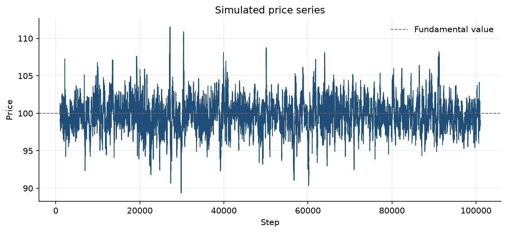
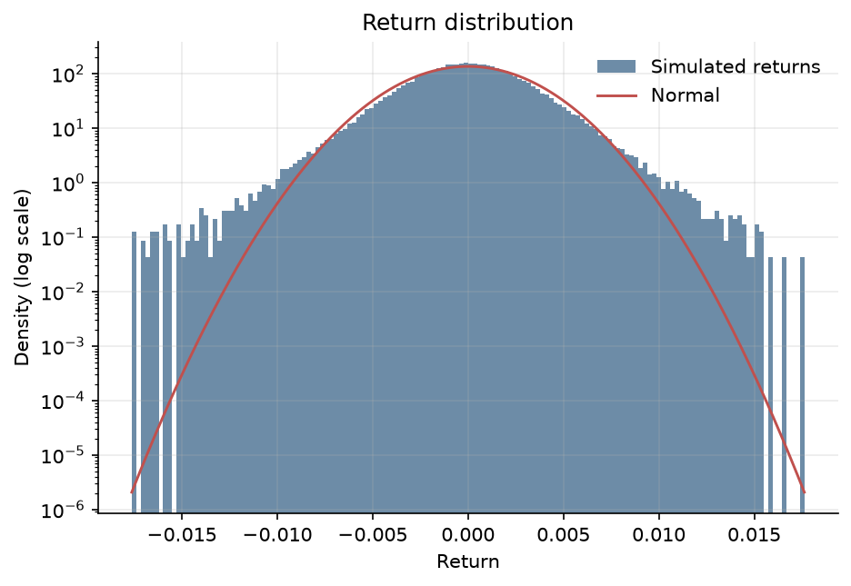
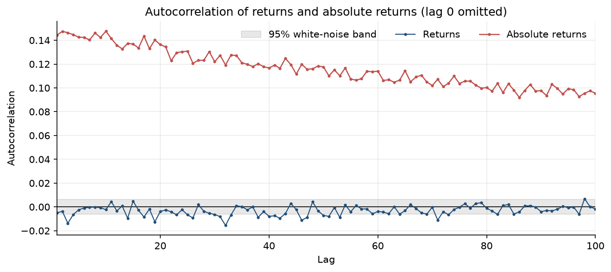
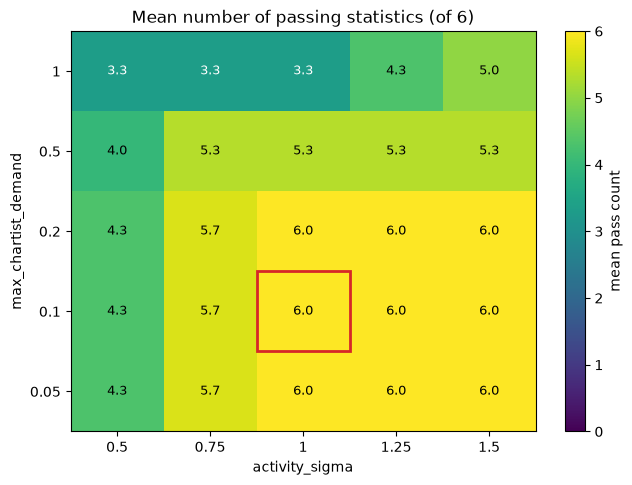
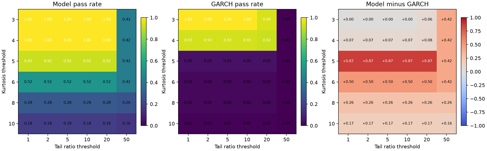

# When the stylized facts come from activity, not agents

**A reproducible negative result for a three-type agent-based market**

Iker Abad

23 November 2026

## Abstract

Agent-based models of financial markets often claim that heterogeneous
behaviour explains the stylized facts of returns. This paper tests that claim
with a small, reproducible model of 200 fundamentalists, chartists and noise
traders. The baseline run reproduces five standard facts: fat tails, near-zero
return autocorrelation, slow autocorrelation of absolute returns, a positive
volume-volatility correlation and a high tail-exceedance ratio. The result is
robust across 50 seeds, across sample sizes from 10,000 to 200,000 steps and
inside contiguous blocks of the baseline series. The central result is
negative. A noise-only version, with the three agent types removed, passes all
six statistic rows. Removing the persistent activity state instead leaves 1.33
passing rows on average and no seed passes all six. The activity process, not
the agent composition, carries the statistical facts. The paper documents this
result, compares the model with Gaussian, Student-t and GARCH benchmarks, and
argues that a passing fact table is not evidence for a behavioural mechanism
unless an ablation shows that the mechanism is necessary.

## 1. Motivation

Agent-based models are attractive because they connect market outcomes to
individual behaviour. A typical model puts fundamentalists, chartists and noise
traders in a market, simulates their orders and reports that the resulting
returns have fat tails, volatility clustering and weak return
autocorrelation. The narrative is that heterogeneity and interaction produce
the facts. The narrative is plausible, but a passing fact table does not prove
it. A reduced-form process with the same statistical properties can pass the
same table.

This paper separates two questions that are often mixed. The first is whether
the model reproduces the facts. The second is which part of the model is
responsible. The first question is answered with a baseline table and a
robustness study. The second is answered with an ablation study. The answer to
the second question is the main contribution, and it is negative for the
behavioural interpretation.

The model is deliberately small. It is a toy market, not a forecast. The
fundamental value is constant, agents do not update wealth, there is no order
book and there are no dividends, news or transaction costs. These omissions
are limitations, but they also make the experiment clean. If a mechanism is
not necessary in this controlled setting, it is unlikely to be necessary in a
more complex one without additional evidence.

The paper is also a reproducibility exercise. Every table and figure is
generated by a command, the configuration and seed are stored in a JSON file,
and the continuous integration runs the full baseline on Linux and Windows. The
repository is public and the release is archived.

## 2. Model

The market has 200 agents. Each agent belongs to one of three types:
fundamentalist, chartist or noise trader. The baseline fractions are 0.3, 0.4
and 0.3. Every agent has a memory length, a risk-aversion coefficient, a wealth
weight and a persistent activity state. Memory and risk aversion are drawn
from uniform intervals. The wealth weight scales the demand.

### 2.1 Activity

The activity state is the source of the slow dynamics. For agent i at step t:

```text
log a_i(t) = rho_i log a_i(t-1) + sigma_i epsilon_i(t)
```

The persistence rho_i is set by the agent's memory length m_i. The model uses
rho_i = 1 - 1/m_i. Memory is drawn uniformly from 5 to 1,000 steps, so
persistence ranges from 0.8 to 0.999. The innovation scale sigma is a single
parameter, 1.0. The update is scaled by sigma times the square root of
1 - rho_i squared, so the stationary variance is the same for every agent. The
shocks epsilon_i(t) are independent standard normal draws. The activity
multiplies the demand of the agent at every step, so a persistent high-activity
agent keeps submitting large orders for many steps.

The mixture of persistence levels is intentional. A single AR(1) process has
an exponential autocorrelation. A mixture of AR(1) processes with different
half-lives produces an autocorrelation that decays slowly over the simulated
window. The decay is not a power law, and the paper does not claim true long
memory. It is a finite-window approximation.

### 2.2 Demand rules

A fundamentalist compares the current price with the fundamental value and
submits a demand proportional to the expected gap. Each fundamentalist has an
idiosyncratic bias, so the group does not act as a single trader. The demand
also depends on the agent's risk aversion, wealth weight and activity.

A chartist uses the recent price history. The agent computes a trend signal
over its memory window and submits a demand in the direction of the trend. The
chartist demand is capped by a parameter. The cap is deliberately small. A
strong chartist component creates positive return autocorrelation, which
contradicts the second fact. The weak chartist is a design choice, not a
discovery.

A noise trader submits a random demand with a fixed scale. The random demand
is multiplied by the activity state. This detail is important. The activity
process enters every demand, including the noise demand.

### 2.3 Price impact

The price adjusts linearly to the excess demand:

```text
p(t+1) = p(t) exp(lambda * (D(t) / N))
```

where D(t) is the sum of the demands, N is the number of agents and lambda is
the impact coefficient. The exponential form keeps the price positive. The
linear impact is a simplification. A real market has a nonlinear order book and
a transient impact that decays over time.

The fundamental value is constant at 100. The price gap is stationary around
this value. The baseline half-life of the gap is 64.6 steps. The
fundamentalists provide the anchoring.

### 2.4 Parameters

The baseline configuration is stored in `configs/baseline.json`. The main
parameters are:

| Parameter | Value |
| --- | --- |
| Agents | 200 |
| Fundamentalists | 0.3 |
| Chartists | 0.4 |
| Noise traders | 0.3 |
| Memory range | 5 to 1,000 steps |
| Risk aversion | 0.5 to 2.0 |
| Wealth weight | 0.5 to 1.5 |
| Fundamental bias std | 0.03 |
| Activity innovation sigma | 1.0 |
| Impact coefficient | 0.05 |
| Chartist demand cap | 0.1 |
| Fundamental value | 100 |
| Steps | 101,000 |
| Burn-in | 1,000 |
| Seed | 20261122 |

The model is frozen for the 1.0.0 release. No parameter or process is added in
this paper.

## 3. Facts and criteria

The paper measures five facts with six statistic rows. The third fact uses two
lags, so the table has six rows.

1. Fat tails: kurtosis above 3.
2. Near-zero return autocorrelation: absolute value of the lag-1
   autocorrelation below 0.05.
3. Volatility clustering: autocorrelation of absolute returns above 0.05 at
   lag 1 and above 0.02 at lag 50.
4. Volume-volatility correlation: correlation between volume and absolute
   returns above 0.2.
5. Tail exceedance: ratio of the empirical probability of a four-standard-
   deviation return to the Gaussian probability above 1.

The thresholds are explicit and stored in the configuration. They are not
estimated from the data. The kurtosis threshold of 3 and the tail-ratio
threshold of 1 are weak, as Section 6 shows. The main table keeps them because
they were fixed before the benchmark study. A stricter companion table is
reported separately.

The baseline run uses 101,000 simulated steps and discards the first 1,000. The
analysis window therefore has 100,000 returns. The baseline seed is 20261122.

## 4. Baseline and robustness

The baseline passes all six rows:

| Fact | Statistic | Value | Criterion | Pass |
| --- | --- | ---: | --- | :---: |
| 1 | Kurtosis | 5.488 | > 3 | yes |
| 2 | ACF(returns, lag 1) | -0.004945 | abs < 0.05 | yes |
| 3 | ACF(abs(returns), lag 1) | 0.1443 | > 0.05 | yes |
| 3 | ACF(abs(returns), lag 50) | 0.1176 | > 0.02 | yes |
| 4 | corr(volume, abs(returns)) | 0.5016 | > 0.2 | yes |
| 5 | P(abs(r) > 4 sd) / P_normal | 32.21 | > 1 | yes |



The price series stays around the fundamental value. The log gap has an AR(1)
coefficient of 0.9893 and a half-life of 64.6 steps.



The return histogram has a peaked centre and fat tails. The normal density is
shown on a logarithmic scale for comparison.



The autocorrelation of returns is essentially zero at all lags. The
autocorrelation of absolute returns decays slowly and remains positive at lag
50.

The result is not a single-seed accident. A 20-seed hold-out, using seeds that
were not used to choose the parameters, passes all six rows in 20 of 20 seeds.
An extended 50-seed hold-out passes in 50 of 50. The 95% Wilson interval for
the all-pass rate is [0.929, 1.000].

The baseline window is also stable inside itself. The 100,000 returns are split
into ten contiguous blocks of 10,000. Every row passes in every block. Across
20 seeds and 200 blocks, five rows pass in all 200 blocks and the return
autocorrelation passes in 199. The single failure is seed 1020, block 10, with
a return autocorrelation of -0.05138 against a limit of 0.05.

The sample size does not change the conclusion. At 10,000, 50,000, 100,000 and
200,000 steps, all six rows pass in all three seeds per size. Kurtosis is the
least stable statistic, as expected from its dependence on rare large returns.

## 5. Ablations: the negative result

The ablation study removes one component at a time and runs three seeds per
variant. The baseline row is the reference. The table reports how many seeds
pass each statistic.

| Ablation | Kurtosis | ACF(returns, 1) | ACF(abs, 1) | ACF(abs, 50) | corr(volume, abs) | Tail ratio | Mean pass | All-pass seeds |
| --- | ---: | ---: | ---: | ---: | ---: | ---: | ---: | ---: |
| baseline | 3/3 | 3/3 | 3/3 | 3/3 | 3/3 | 3/3 | 6.00 | 3/3 |
| no_chartists | 3/3 | 3/3 | 3/3 | 3/3 | 3/3 | 3/3 | 6.00 | 3/3 |
| no_fundamentalists | 3/3 | 3/3 | 3/3 | 3/3 | 3/3 | 3/3 | 6.00 | 3/3 |
| noise_only | 3/3 | 3/3 | 3/3 | 3/3 | 3/3 | 3/3 | 6.00 | 3/3 |
| no_activity | 0/3 | 3/3 | 0/3 | 0/3 | 0/3 | 1/3 | 1.33 | 0/3 |
| fixed_memory | 3/3 | 3/3 | 3/3 | 3/3 | 3/3 | 3/3 | 6.00 | 3/3 |
| homogeneous_risk | 3/3 | 3/3 | 3/3 | 3/3 | 3/3 | 3/3 | 6.00 | 3/3 |
| homogeneous_wealth | 3/3 | 3/3 | 3/3 | 3/3 | 3/3 | 3/3 | 6.00 | 3/3 |
| no_bias | 3/3 | 3/3 | 3/3 | 3/3 | 3/3 | 3/3 | 6.00 | 3/3 |
| no_noise_demand | 3/3 | 0/3 | 3/3 | 3/3 | 3/3 | 3/3 | 5.00 | 0/3 |

The noise-only variant passes all six rows in all three seeds. Removing the
chartists, the fundamentalists or both does not break the facts. Removing the
activity process leaves 1.33 passing rows on average and no seed passes all
six. Removing the noise demand leaves 5.00 rows and no seed passes all six,
because the return autocorrelation becomes too strong.

The conclusion is direct. The three agent types are not necessary for the six
statistic rows in this model. The persistent activity process is necessary. The
types shape the price level and can break the near-zero return autocorrelation
when the noise demand is removed, but they are not the source of the fat tails
or the volatility clustering.

This is the central result of the paper. It is not a bug to fix. It is what the
model says.

The result is also visible in the parameter map. The baseline cell, with
activity volatility 1.0 and a chartist cap of 0.1, passes all six rows in three
of three seeds. Lowering activity volatility to 0.5 reduces the mean to 4.33
passing rows and no seed passes all six.



## 6. What the facts identify

The six rows are not unique to the agent-based model. Three synthetic
benchmarks are compared with the model on the five price facts. The volume fact
is omitted because the benchmarks have no volume.

| Series | Kurtosis | ACF(returns, 1) | ACF(abs, 1) | ACF(abs, 50) | Tail ratio | Facts passing |
| --- | ---: | ---: | ---: | ---: | ---: | ---: |
| market-sim baseline | 5.488 | -0.004945 | 0.1443 | 0.1176 | 32.21 | 5/5 |
| Gaussian | 3.02 | -0.007337 | 0.003022 | -0.003043 | 0.6315 | 2/5 |
| Student-t(5) | 8.18 | 0.0008168 | -0.008656 | -0.001822 | 58.25 | 3/5 |
| GARCH(1,1) | 4.096 | -0.0004496 | 0.1532 | 0.04533 | 22.58 | 5/5 |

Gaussian returns fail the fat-tail and clustering facts. Student-t returns
have fat tails but no clustering. GARCH passes all five price facts in this
sample. The five facts alone do not distinguish the agent-based model from a
simple stochastic-volatility benchmark.

Repeating the benchmarks over 100 independent series makes the weakness
visible. Under the original criteria, Gaussian returns pass the kurtosis fact
in 52 of 100 samples and the tail-ratio fact in 47 of 100. A sample kurtosis
above 3 is weak evidence of fat tails at this sample size. GARCH passes all
five facts in 100 of 100 samples.

Tightening the two weak tail criteria to kurtosis above 5 and tail ratio above
10 changes the result. The model passes all five in 46 of 50 seeds. GARCH
passes in 5 of 100. Gaussian and Student-t pass in none. The stricter criteria
separate the model from the benchmarks, but the main table keeps the original
thresholds because they were fixed before the benchmark study.

The Gaussian null distribution explains the weakness. Over 1,000 Gaussian
series of 100,000 returns, the 5% quantile of kurtosis is 2.975, the median is
3.001 and the 95% quantile is 3.028. The threshold of 3 is the median of the
null. The model value of 5.488 is far outside the 95% quantile. The tail ratio
behaves in the same way. Its Gaussian 95% quantile is 1.737 and the model value
is 32.21. The return autocorrelation is small in magnitude, near the 5%
quantile of the null. The absolute-return autocorrelations are far above the
Gaussian 95% quantile.

The area under the ROC curve measures how much each statistic separates the
model from a benchmark. Against GARCH, kurtosis has an AUC of 0.962 with a 95%
bootstrap interval of [0.93, 0.99]. ACF(abs, 50) has an AUC of 0.989 with
[0.97, 1.00]. ACF(abs, 1) has an AUC of 0.517 with [0.40, 0.63], which
contains 0.5. The fast clustering fact does not distinguish the two models. The
slow autocorrelation does.



The threshold grid shows the separation region. At kurtosis above 4 and tail
ratio above 10, the model passes all five in 50 of 50 seeds and GARCH in 93 of
100. At kurtosis above 5, the model passes 46 of 50 and GARCH falls to 5 of
100. The separation is sharpest between 4 and 5.

The additional facts point in the same direction. The model reproduces the
long-memory DFA exponent and aggregational Gaussianity, but not the leverage
effect, gain/loss asymmetry or volume lead-lag. Against GARCH, the DFA exponent
has an AUC of 0.998. Aggregational Gaussianity has 0.804. Leverage has 0.298
and gain/loss asymmetry has 0.391. The model's leverage median is slightly
positive, 0.00426, so it does not reproduce the usual negative sign. The DFA
exponent and ACF(abs, 50) are two views of the same slow persistence.

The facts identify long memory, not the three agent types. This is consistent
with the ablation result. The model's distinctive statistical content is the
activity process.

## 7. Limitations

The fundamental value is constant. The model has no news, no dividends and no
long-run trends. It cannot produce bubbles or regime changes in the fundamental
value.

Agents do not update their wealth. A real market selects on performance, and
the composition of strategies changes over time. The model keeps the
composition fixed.

There is no order book. The price impact is linear in aggregate excess demand
and does not depend on the shape of the book or on the order flow.

The activity process is reduced form. It produces the clustering and the tails,
but it is not derived from wealth dynamics, chartist herding or learning. The
paper treats it as a statistical mechanism, not as a behavioural explanation.

The model does not reproduce the leverage effect or gain/loss asymmetry. The
demand rules are symmetric. The volume-volatility correlation is partly
mechanical because volume is gross demand and the return is proportional to
net demand.

The chartists are weak by design. Stronger chartists create positive return
autocorrelation, which breaks the second fact. The weak chartist is a
constraint of the experiment, not a calibrated estimate.

The thresholds are explicit choices. The kurtosis and tail-ratio thresholds
are weak under the original criteria. The paper reports the stricter companion
table to make this visible.

The model is one specification. The ablation result is a statement about this
model, not about every agent-based model. A different model with wealth
dynamics, learning or a realistic order book could need the agent types for
the same facts.

## 8. Reproducibility

The repository is public at `https://github.com/IkerAbad/market-sim`. The
package requires Python 3.12 or newer. The reference environment uses Python
3.14.5, NumPy 2.5.5 and Matplotlib 3.11.2. The versions are pinned in
`constraints-reference.txt`.

A clean clone can regenerate the baseline, the figures and every analysis with
one command:

```bash
python -m pip install -e ".[dev]"
python scripts/reproduce_all.py --jobs 8
```

The configuration and seed are in `configs/baseline.json`. The same seed
produces the same series. The committed outputs have SHA256 hashes in
`docs/reproducibility.md`. The check is automated:

```bash
python scripts/check_hashes.py
python scripts/compare_baseline.py
```

The continuous integration runs the tests on Ubuntu and Windows with Python
3.12, 3.13 and 3.14. A pinned reference job regenerates the baseline and
compares every metric with the committed summary. A reproducibility job runs
the same seed on Ubuntu and Windows and compares the result hashes. The series
is bit-for-bit identical at ten decimal places. The metrics summary is compared
after rounding to six significant digits, because the last bits of the raw
floats depend on the platform math library. The container builds from the same
source and runs a short simulation.

The paper itself is reproducible. Every number in the tables comes from a
command in the repository. The figures are generated by
`scripts/make_figures.py`, `scripts/run_phase_diagram.py` and
`scripts/run_discrimination.py`.

## 9. Implications

The first implication is methodological. A passing fact table is not evidence
for a behavioural mechanism. The mechanism must be shown to be necessary. The
ablation study is the cheapest way to do that. In this model, the ablation
removes the three agent types and the facts survive. The behavioural story does
not survive the same test.

The second implication is about benchmarks. GARCH passes the five price facts.
A model that only reports the facts cannot claim to be different from GARCH.
The discriminating fact is the slow autocorrelation of absolute returns, and
its AUC against GARCH is 0.989. The fast autocorrelation is not a discriminator
because GARCH also produces it.

The third implication is about negative results. A model that shows its own
limitations is more useful than a model that hides them. The activity process
is a reduced-form mechanism. It is honest to say that it carries the facts. The
three agent types add a price level and a behavioural narrative, but they are
not necessary for the six rows.

The fourth implication is pedagogical. The model is small enough to read, run
and modify in a first course on simulation. It shows the difference between a
model that fits and a model that explains. It also shows how to report a
negative result without hiding it.

The model is not a forecasting tool. It is a controlled experiment about the
relationship between agent behaviour and return statistics. The experiment
says that, in this specification, the statistics come from activity.

## References

Bollerslev, T. (1986). Generalized autoregressive conditional
heteroskedasticity. *Journal of Econometrics*, 31(3), 307-327.

Cont, R. (2001). Empirical properties of asset returns: stylized facts and
statistical issues. *Quantitative Finance*, 1(2), 223-236.

Engle, R. F. (1982). Autoregressive conditional heteroscedasticity with
estimates of the variance of United Kingdom inflation. *Econometrica*, 50(4),
987-1007.

Hommes, C. H. (2006). Heterogeneous agent models in economics and finance. In
*Handbook of Computational Economics*, volume 2, 1109-1186. Elsevier.

LeBaron, B. (2006). Agent-based computational finance. In *Handbook of
Computational Economics*, volume 2, 1187-1233. Elsevier.

Lux, T., and Marchesi, M. (2000). Volatility clustering in financial markets: a
microsimulation of interacting agents. *International Journal of Theoretical
and Applied Finance*, 3(4), 675-702.

Mandelbrot, B. (1963). The variation of certain speculative prices. *Journal of
Business*, 36(4), 394-419.
